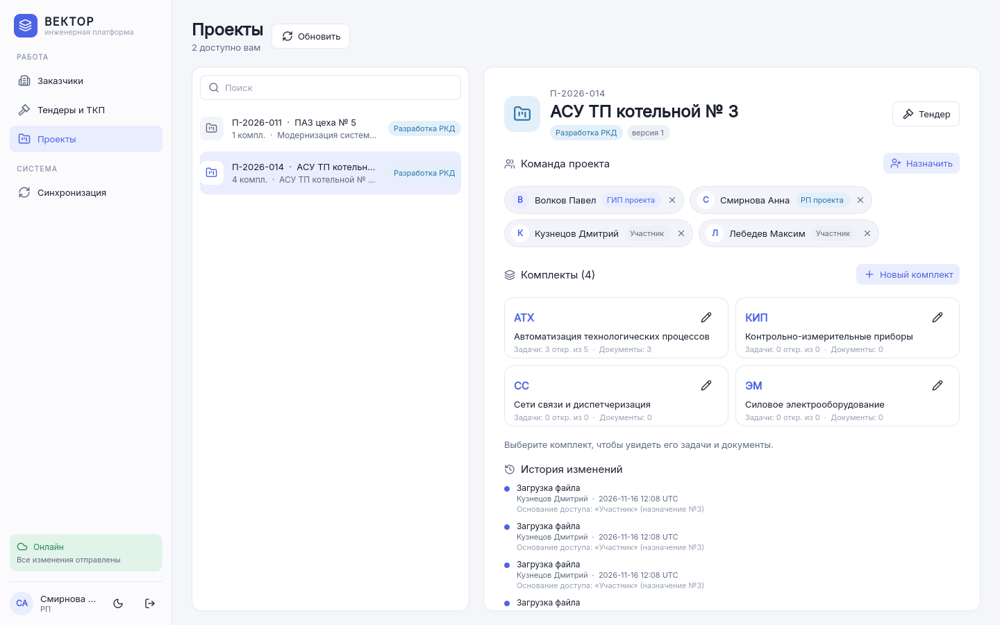
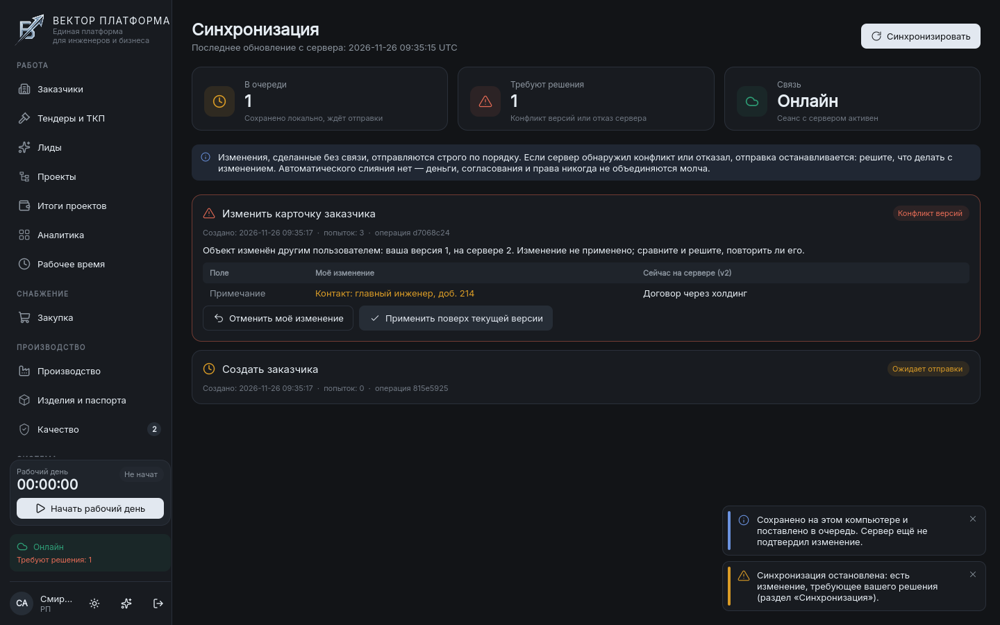

# ВЕКТОР / VECTOR

**Рабочая среда инженерной компании**: от заказчика и тендера до проекта, комплектов, документов,
производства и эксплуатации — в одном настольном приложении для Windows с собственным сервером компании.

```
заказчик → сделка → тендер/ТКП → явное начало РКД → проект → комплект → документ/версии → задачи/замечания
→ зафиксированная спецификация → закупка/склад → ТП → производственное задание → экземпляр/паспорт
→ эксплуатация → рекламация/ECO
```

> **Статус: ранняя разработка (0.2.0.dev0).** Работает первый вертикальный срез
> «заказчик → тендер/ТКП → начало РКД → проект → комплект». Задачи и документы с версиями — в работе.
> Это не готовый продукт; завершение каждого этапа подтверждает только владелец продукта.

<p align="center">
  
  
</p>

---

## Содержание
- [Что умеет сейчас](#что-умеет-сейчас)
- [Принципы](#принципы)
- [Архитектура](#архитектура)
- [Структура репозитория](#структура-репозитория)
- [Быстрый старт для разработчика](#быстрый-старт-для-разработчика)
- [Тесты](#тесты)
- [Безопасность и резервное копирование](#безопасность-и-резервное-копирование)
- [Документация](#документация)
- [Как вносить изменения](#как-вносить-изменения)

## Что умеет сейчас

| Область | Состояние |
|---|---|
| Заказчики, тендеры, ТКП (черновик → согласование → регистрация отправки) | ✅ сервер + интерфейс |
| Явное начало РКД: проект создаётся только из выигранного тендера, один проект на тендер | ✅ |
| Команда проекта: ГИП (назначает только администратор), РП, участники | ✅ |
| Комплекты проекта | ✅ |
| Работа без связи: локальная зашифрованная очередь, повтор без дублей, конфликты версий | ✅ |
| Учётные записи продукта, роли с историей выдач, блокировки, смена/сброс пароля | ✅ |
| Журнал аудита (только добавление), история объектов | ✅ |
| Зашифрованные резервные копии с проверкой и восстановлением на PostgreSQL / MS SQL / SQLite | ✅ (MS SQL не проверен на реальном сервере) |
| Задачи, документы и версии | 🟡 следующий шаг |
| Спецификации, закупка, склад, производство, эксплуатация | 📐 спроектировано (см. `docs/blueprint`), не реализовано |
| Windows-инсталлятор, подпись, проверка на DPI | ⛔ не сделано |

## Принципы

1. **Сервер — источник истины.** Клиент никогда не подключается к СУБД напрямую; права проверяются на сервере
   в той же транзакции, что и изменение. Роли в кэше клиента — только подсказка для интерфейса.
2. **Ничего не сливается молча.** Деньги, согласования, права, резервы и файлы при конфликте версий
   не объединяются автоматически — решение принимает человек.
3. **Деньги — только Decimal.** В JSON — строки, в PostgreSQL / MS SQL — `NUMERIC(18,4)`. Никаких float.
   «Ноль», «пусто», «неизвестно» и «ошибка» — разные состояния.
4. **Ничего не придумываем.** Права, пороги, налоги, округления, юридический смысл — только от владельца;
   временные предположения явно записаны в журнале решений (`docs/blueprint/12-decision-log.md`).
5. **Минимум привилегий.** Администратор управляет учётными записями, но не получает бизнес-прав автоматически.
6. **Честный интерфейс.** Отправка ТКП «зарегистрирована» ≠ «получена»; недоступные данные так и подписаны.

## Архитектура

```
┌──────────────────────────────┐        HTTPS (TLS, свой CA)       ┌───────────────────────────────┐
│  Клиент Windows (PySide6/QML)│ ───────────────────────────────▶  │  Сервер ВЕКТОР (on-prem)      │
│  • интерфейс Qt Quick        │   /api/v1: login · command · query│  • Starlette + uvicorn        │
│  • офлайн-ядро (sync.py)     │                                   │  • сервис команд (service.py) │
│  • зашифрованный кэш (vault) │                                   │  • права (authz.py)           │
└──────────────────────────────┘                                   │  • аудит, резервные копии     │
                                                                    └──────────────┬────────────────┘
                                                                                   │ SQLAlchemy 2
                                                                     PostgreSQL · MS SQL · (SQLite — тесты/пилот)
```

Модульный монолит. Все изменения — **команды** из каталога `contracts/command-catalog.slice1.json`
с устойчивым `operation_id` (повтор не создаёт дубль) и ожидаемой версией объекта (обнаружение конфликтов).
Подробно: `docs/blueprint/05-architecture.md`, выбор стека — решение D-16.

## Структура репозитория

| Путь | Что там |
|---|---|
| `contracts/` | **Источник истины**: каталог команд, матрица прав, переходы статусов, денежные тест-векторы (JSON) |
| `src/vector/core/` | Общее для клиента и сервера: деньги (`money.py`), ошибки, загрузка контрактов |
| `src/vector/server/` | Сервер: схема БД, сервис команд, права, безопасность учётных записей, API, CLI, резервные копии |
| `src/vector/client/` | Клиент: транспорт, офлайн-синхронизация, шифрованный кэш, мост к QML (`backend.py`), интерфейс (`qml/`) |
| `tests/` | `core`, `server` (SQLite + PostgreSQL), `client` (офлайн), `ui` (настоящий QML offscreen) |
| `spikes/reference-core/` | Эталонное ядро на стандартной библиотеке — исполняемая спецификация инвариантов среза 1 |
| `tools/` | Синхронизация контрактов, стенд интерфейса и скриншоты, стабы для offscreen-тестов |
| `docs/blueprint/` | Проектная документация 00–16: домен, роли, сценарии, права, офлайн, решения, отчёты |
| `docs/screenshots/` | Скриншоты интерфейса, снятые автоматически (основа справки) |

## Быстрый старт для разработчика

Нужен Python 3.11+.

```bash
python -m venv .venv
. .venv/bin/activate                     # Windows: .venv\Scripts\activate
pip install -e ".[server,client,dev]"

# 1. Тестовый CA и TLS-сертификат (ТОЛЬКО пилот/разработка)
vector-server dev-cert --dir ./pilot/certs --host localhost
# 2. Конфигурация: пример с комментариями
mkdir -p pilot/backups && cp config/vector-server.example.toml pilot/vector-server.toml
export VECTOR_DB_URL="sqlite:///./pilot/vector.sqlite"   # для пилота; в работе — PostgreSQL или MS SQL
# 3. Схема и первый администратор (пароль спрашивается, в командной строке не передаётся)
vector-server init  --config ./pilot/vector-server.toml
vector-server check --config ./pilot/vector-server.toml
# 4. Сервер
vector-server serve --config ./pilot/vector-server.toml
# 5. Клиент (в другом окне): адрес https://localhost:8443, файл CA — ./pilot/certs/ca.pem
vector-client
```

Справка по командам: `vector-server --help`. Все параметры описаны в `config/vector-server.example.toml`.

## Тесты

```bash
python -m pytest -q -p no:cacheprovider tests          # всё: core, server (SQLite+PostgreSQL), client, ui
python -m pytest -q tests/server -k sqlite             # быстро, без PostgreSQL
python -m pytest -q -m ui tests/ui                     # интерфейс offscreen
(cd spikes/reference-core/tests && python -m unittest) # эталонное ядро
python tools/sync_contracts.py --check                 # контракты синхронизированы с пакетом
```

- PostgreSQL для тестов поднимается **временно и встроенно** (`pgserver`), реальные базы не используются.
- UI-тесты на Linux без GPU требуют стабов: `python tools/qt_offscreen_stubs.py <site-packages> .venv/stubgl`
  и `LD_LIBRARY_PATH=.venv/stubgl`.
- Классы проверок: **A** — логика/контракты, **B** — на реальной СУБД (встроенный PostgreSQL), **C** — Windows, DPI,
  реальный MS SQL, инсталлятор (только с разрешения владельца, пока не выполнялись).

Последний полный прогон: `236 passed` (см. `docs/blueprint/16-slice1-ui-report.md`).

## Безопасность и резервное копирование

- Пароли — Argon2id; единое сообщение при неверном входе; блокировка и ограничение частоты по адресу.
- Сеансы с простоем и абсолютным сроком; отзыв при смене/сбросе пароля и отключении.
- Локальный кэш клиента зашифрован (ключ — в хранилище ОС); офлайн-вход ограничен сроком.
- Аудит только на добавление: кто, когда, с какого устройства, на основании какой роли/назначения.
- Резервная копия: `vector-server backup` → AES-256-GCM по блокам, проверка после записи, ротация;
  восстановление только в пустую БД с пересчётом и проверкой (`vector-server restore`).

Как сообщить об уязвимости — `SECURITY.md`.

## Документация

Начните с `docs/blueprint/00-index.md`. Ключевое:
`04-permissions.md` (права), `06-offline-matrix.md` (что можно без связи), `12-decision-log.md` (решения и
временные предположения), `11-traceability.md` (требования R-01..R-46 → реализация → тесты).
История изменений — `CHANGELOG.md`.

## Как вносить изменения

См. `CONTRIBUTING.md`: небольшие изменения с понятным откатом, подробные комментарии в коде,
тесты к каждому правилу, отчёт по шагу в формате раздела 17.

## Лицензия

Проприетарное программное обеспечение. Условия использования определяет владелец продукта.
Сторонние компоненты: шрифт Inter (SIL OFL 1.1), иконки Lucide (ISC) — лицензии в `src/vector/client/assets/`.
