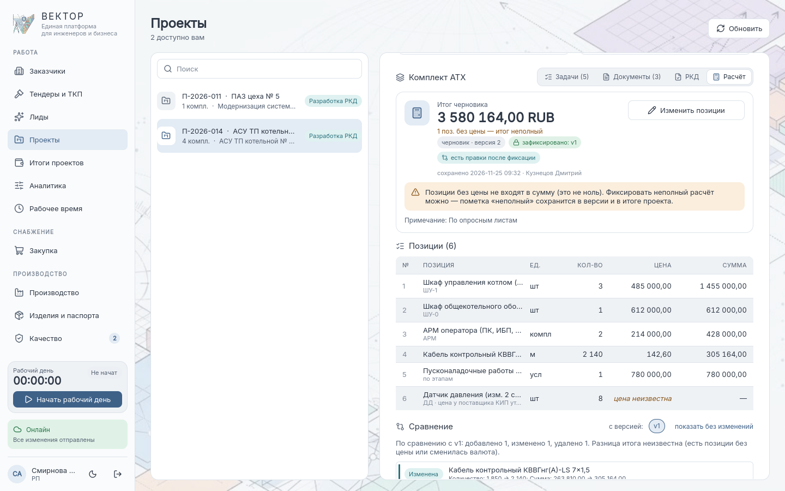

# ВЕКТОР / VECTOR

<p align="center"></p>

**Рабочая среда инженерной компании**: от заказчика и тендера до проекта, комплектов, документов,
производства и эксплуатации — в одном настольном приложении для Windows с собственным сервером компании.

```
заказчик → сделка → тендер/ТКП → явное начало РКД → проект → комплект → документ/версии → задачи/замечания
→ зафиксированная спецификация → закупка/склад → ТП → производственное задание → экземпляр/паспорт
→ эксплуатация → рекламация/ECO
```

<sub>**ТКП** — технико-коммерческое предложение; **РКД** — рабочая конструкторская документация; **ТП** —
технологический процесс; **ECO** — извещение об изменении (Engineering Change Order). Все сокращения — в
[справочнике](docs/manual/reference.md#5-сокращения) и в программе (клавиша `F1`, подсказки при наведении мыши).</sub>

> **Статус: ранняя разработка (0.2.0.dev0).** Работает первый вертикальный срез
> «заказчик → тендер/ТКП → начало РКД → проект → комплект → задача → документ с версиями»
> и сценарий С3 «расчёт комплекта → фиксация версии → ревизия итога проекта», склад и закупка (С4),
> производство (С5, шаги 1–6: техпроцесс → наряд со снимком → исполнение операций офлайн → закрытие).
> Это не готовый продукт; завершение каждого этапа подтверждает только владелец продукта.
>
> **Попробовать на своём ПК** (сервер + клиент + демо-данные, ~15 минут): **[docs/ops/test-pc.md](docs/ops/test-pc.md)**.

<p align="center">
  
  
</p>

---

## Содержание
- [Что умеет сейчас](#что-умеет-сейчас)
- [Принципы](#принципы)
- [Архитектура](#архитектура)
- [Структура репозитория](#структура-репозитория)
- [Попробовать на своём ПК](#попробовать-на-своём-пк)
- [Быстрый старт для разработчика](#быстрый-старт-для-разработчика)
- [Тесты](#тесты)
- [Безопасность и резервное копирование](#безопасность-и-резервное-копирование)
- [Документация](#документация)
- [Как вносить изменения](#как-вносить-изменения)

## Что умеет сейчас

| Область | Состояние |
|---|---|
| Заказчики, тендеры, ТКП (черновик → согласование → регистрация отправки) | ✅ сервер + интерфейс |
| Явное начало РКД: проект создаётся только из выигранного тендера, один проект на тендер | ✅ |
| Команда проекта: ГИП (назначает только администратор), РП, участники | ✅ |
| Комплекты проекта | ✅ |
| Работа без связи: локальная зашифрованная очередь, повтор без дублей, конфликты версий | ✅ |
| Учётные записи продукта, роли с историей выдач, блокировки, смена/сброс пароля | ✅ |
| Журнал аудита (только добавление), история объектов | ✅ |
| Зашифрованные резервные копии с проверкой и восстановлением на PostgreSQL / MS SQL / SQLite | ✅ (MS SQL не проверен на реальном сервере) |
| Задачи комплекта (статусы, исполнитель, срок), документы с неизменяемыми версиями файлов (SHA-256, потоковая передача) | ✅ |
| Расчёт комплекта: черновик офлайн, фиксация ГИП → версия vN, сравнение версий, «цена неизвестна» ≠ 0, вставка из Excel | ✅ сервер + интерфейс |
| Итог проекта только из зафиксированных версий: ревизии с историей, по валютам; раздел для бухгалтерии | ✅ |
| Обновление схемы БД `vector-server migrate` с проверенной копией до изменений | ✅ (MS SQL не проверен) |
| Склад: номенклатура, склады, приход, выдача, сторно, резервы, перемещение между складами со статусом «в пути» (приёмка с актом недостачи, возврат или акт об утрате; способ подписи актов — настройка: флажок / пароль / КЭП); остатки сверяются с неизменяемым журналом | ✅ сервер + интерфейс |
| Закупка: потребность из зафиксированной версии расчёта, покрытие резервами, ручное сопоставление, аналоги и пересчёт единиц | ✅ сервер + интерфейс |
| Заказы поставщикам: справочник поставщиков с реквизитами и договорами, черновик офлайн → **обязательное согласование** («четыре глаза») → размещение (условия замораживаются) → закрытие/отмена, НДС раздельно (без НДС / НДС / с НДС) с самопроверкой и сверкой со счётом поставщика, приём поставки складом не больше заказанного, «заказано, ждём» в потребности; цены видят закупка, бухгалтерия, согласующий и руководитель отдела | ✅ сервер + интерфейс |
| Замещение ролей — глобальных и в проекте (ГИП, РП, участник): передача роли на срок с причиной (сам или руководитель за отсутствующего), основание каждого решения («замещает …»), покрытие ролей, руководитель отдела — резервный согласующий | ✅ сервер + интерфейс |
| Уведомления в программе: заказ на согласовании — согласующим и руководителю отдела, решения по заказу — закупке, замещения — их участникам; значок непрочитанных, переход к заказу | ✅ сервер + интерфейс (без почты) |
| Настройки компании с версиями (публикует администратор) | ✅ первая настройка |
| Производство: техпроцессы (черновик офлайн, утверждение «четыре глаза», ревизии), наряды с неизменяемым снимком состава и операций, «Мои операции» исполнителя с таймером **без связи**, замены с предпросмотром и причиной, выдача материалов на наряд, закрытие по операциям и материалам | ✅ сервер + интерфейс (С5, шаги 1–6) |
| Подсказки при наведении мыши у каждой кнопки, пункта меню, вкладки, статуса и поля (что произойдёт, нужна ли связь, расшифровка сокращений); раздел «Сокращения и подсказки» (`F1`) — 110 сокращений с поиском | ✅ интерфейс (D-37) |
| Изделия и паспорта: экземпляры с заводскими номерами по закрытому наряду, неизменяемый состав с точными связями (наряд, SHA-256 снимка, редакция ТП, версия расчёта), паспорт-черновик по шаблону-мастеру **без связи**, черновой экспорт «Черновик, не сертификат» с журналом, передача заказчику, сервис и замены | ✅ сервер + интерфейс (С5, шаги 7–9) |
| Качество: рекламации по экземплярам, партиям (нарядам) и проектам без заводского номера, тяжесть и категория дефекта, срок ответа заказчику с напоминаниями, роль ОТК (отдел технического контроля) — по проектам, куда сотрудник назначен (D-41); план CAPA (корректирующие и предупреждающие действия), проверка эффективности **другим человеком**, запрос на изменение (ECR, решает ГИП не автор), извещение (ECO) с точными версиями — утверждение «четыре глаза», внедрение, проверка; затронутые экземпляры | ✅ сервер + интерфейс (С5, шаг 10) |
| Рабочее время: дневной отчёт (смена, в т. ч. ночная через полночь; строки по проектам и задачам; без связи — создание, правка, отправка), **отчёт за прошедший день собирает программа** по действиям сотрудника (строки «по таймеру» и «оценка программы», D-43), **обязательная самопроверка** перед отправкой, проверка руководителем отдела «четыре глаза» (принять / вернуть с причиной), исправление после отправки с основанием, неизменяемая история, уведомления; **агрегированные недельные итоги подразделений** на вкладке «На проверке» (D-50, прошлую полную неделю, итоги включают подчинённые подразделения, без персональных действий) | ✅ сервер + интерфейс (учёт по Трудовому кодексу Российской Федерации и согласование сверхурочных — отдельная последующая работа) |
| Оргструктура: филиалы, структуры, отделы, связь «входит в» (дерево без кругов), руководители, сотрудники с должностями (должность прав не даёт), архив, неизменяемый журнал; **дневной отчёт уходит руководителю своего подразделения** (или вышестоящему), видят руководители по цепочке (D-44) | ✅ сервер + интерфейс (ведёт администратор; руководитель подразделения проверяет отчёты своих сотрудников без отдельной роли, D-45) |
| Таймер рабочего дня: «Начать / Перерыв / Продолжить / Завершить день», сколько натикало — **без округления**, перерыв только по кнопке, **без связи** по часам компьютера; окно «Начните рабочий день»; «Я начал раньше» — фактическое начало **через согласование руководителя**, таймер считает день с него; смена дневного отчёта из таймера (D-46) | ✅ сервер + интерфейс |
| Графики работы: справочник (ночные, дни недели, перерыв, «по умолчанию»), назначение подразделению и сотруднику, «учёт не ведётся»; фактическое начало — от графика; окно «Начните рабочий день» **обязательно**; напоминание в конце дня, «Работаю дальше», **автоматическое завершение забытого дня**, «Я работал дольше» через руководителя (D-47) | ✅ сервер + интерфейс |
| Производственный календарь: праздники, сокращённые и рабочие по переносу дни (xmlcalendar.ru; встроены 2024–2027, «Из интернета», «Из файла», с октября программа администратора сама загружает следующий год), ручные правки дней, отметка у графика; окно дня, напоминание и автоматическое завершение — по календарю (D-48) | ✅ сервер + интерфейс |
| Сверхурочные и забытое «Завершить»: отметки дня **«Сверхурочно»** (сверх нормы по графику), **«Работа в выходной день»**, **«Работа в праздничный день»** — под таймером и в дневном отчёте у руководителя; **никакая компьютерная активность не отслеживается**; без ответа после настроенного ожидания день завершается по времени напоминания, если работали дольше — можно направить запрос руководителю; интервалы — настройки компании (D-49, уточнение A-54) | ✅ сервер + интерфейс (серверные заявки/решения руководителя, настройка периода месяц/квартал/год и снимок периода добавлены D-52; пользовательский интерфейс, закрытие периода, юридические проверки согласий/лимитов и обмен с 1С ещё впереди; `docs/blueprint/51-overtime-and-holiday-ledger.md`) |
| Корректировка остатка | 📐 спроектировано (см. `docs/blueprint`), не реализовано |
| Фирменный стиль: логотип, знак, фон, светлая и тёмная темы с проверкой контраста | ✅ |
| Windows-инсталлятор, подпись, проверка на DPI | ⛔ не сделано |

## Принципы

1. **Сервер — источник истины.** Клиент никогда не подключается к СУБД напрямую; права проверяются на сервере
   в той же транзакции, что и изменение. Роли в кэше клиента — только подсказка для интерфейса.
2. **Ничего не сливается молча.** Деньги, согласования, права, резервы и файлы при конфликте версий
   не объединяются автоматически — решение принимает человек.
3. **Деньги — только Decimal.** В JSON — строки, в PostgreSQL / MS SQL — `NUMERIC(18,4)`. Никаких float.
   «Ноль», «пусто», «неизвестно» и «ошибка» — разные состояния.
4. **Ничего не придумываем.** Права, пороги, налоги, округления, юридический смысл — только от владельца;
   временные предположения явно записаны в журнале решений (`docs/blueprint/12-decision-log.md`).
5. **Минимум привилегий.** Администратор управляет учётными записями, но не получает бизнес-прав автоматически.
6. **Честный интерфейс.** Отправка ТКП «зарегистрирована» ≠ «получена»; недоступные данные так и подписаны.

## Архитектура

```
┌──────────────────────────────┐        HTTPS (TLS, свой CA)       ┌───────────────────────────────┐
│  Клиент Windows (PySide6/QML)│ ───────────────────────────────▶  │  Сервер ВЕКТОР (on-prem)      │
│  • интерфейс Qt Quick        │   /api/v1: login · command · query│  • Starlette + uvicorn        │
│  • офлайн-ядро (sync.py)     │                                   │  • сервис команд (service.py) │
│  • зашифрованный кэш (vault) │                                   │  • права (authz.py)           │
└──────────────────────────────┘                                   │  • аудит, резервные копии     │
                                                                    └──────────────┬────────────────┘
                                                                                   │ SQLAlchemy 2
                                                                     PostgreSQL · MS SQL · (SQLite — тесты/пилот)
```

Модульный монолит. Все изменения — **команды** из каталога `contracts/command-catalog.slice1.json`
с устойчивым `operation_id` (повтор не создаёт дубль) и ожидаемой версией объекта (обнаружение конфликтов).
Подробно: `docs/blueprint/05-architecture.md`, выбор стека — решение D-16.

## Структура репозитория

| Путь | Что там |
|---|---|
| `contracts/` | **Источник истины**: каталог команд, матрица прав, переходы статусов, денежные тест-векторы (JSON) |
| `src/vector/core/` | Общее для клиента и сервера: деньги (`money.py`), ошибки, загрузка контрактов |
| `src/vector/server/` | Сервер: схема БД, сервис команд, права, безопасность учётных записей, API, CLI, резервные копии |
| `src/vector/client/` | Клиент: транспорт, офлайн-синхронизация, шифрованный кэш, мост к QML (`backend.py`), интерфейс (`qml/`) |
| `tests/` | `core`, `server` (SQLite + PostgreSQL), `client` (офлайн), `ui` (настоящий QML offscreen) |
| `spikes/reference-core/` | Эталонное ядро на стандартной библиотеке — исполняемая спецификация инвариантов среза 1 |
| `deploy/` | Тестовый стенд для ПК (`test-stand/`: Windows и Linux), юниты systemd для сервера |
| `tools/` | Синхронизация контрактов, стенд интерфейса и скриншоты, стабы для offscreen-тестов |
| `docs/blueprint/` | Проектная документация 00–16: домен, роли, сценарии, права, офлайн, решения, отчёты |
| `docs/screenshots/` | Скриншоты интерфейса, снятые автоматически (основа справки) |

## Попробовать на своём ПК

Тестовый стенд — сервер, клиент и вымышленные демо-данные на одном компьютере (Windows 10/11 или Linux),
без прав администратора и без изменений в системе: [docs/ops/test-pc.md](docs/ops/test-pc.md).
Коротко для Windows: установить Python 3.12/3.13 с python.org → скачать ZIP репозитория → запустить
`deploy\test-stand\windows\setup.cmd` → ярлыки «ВЕКТОР — сервер (тест)» и «ВЕКТОР — клиент (тест)».

## Быстрый старт для разработчика

Нужен Python 3.11+.

```bash
python -m venv .venv
. .venv/bin/activate                     # Windows: .venv\Scripts\activate
pip install -e ".[server,client,dev]"

# 1. Тестовый CA и TLS-сертификат (ТОЛЬКО пилот/разработка)
vector-server dev-cert --dir ./pilot/certs --host localhost
# 2. Конфигурация: пример с комментариями
mkdir -p pilot/backups && cp config/vector-server.example.toml pilot/vector-server.toml
export VECTOR_DB_URL="sqlite:///./pilot/vector.sqlite"   # для пилота; в работе — PostgreSQL или MS SQL
# 3. Схема и первый администратор (пароль спрашивается, в командной строке не передаётся)
vector-server init  --config ./pilot/vector-server.toml
vector-server check --config ./pilot/vector-server.toml
# 4. Сервер
vector-server serve --config ./pilot/vector-server.toml
# 5. Клиент (в другом окне): адрес https://localhost:8443, файл CA — ./pilot/certs/ca.pem
vector-client
```

Справка по командам: `vector-server --help`. Все параметры описаны в `config/vector-server.example.toml`.

## Тесты

```bash
python -m pytest -q -p no:cacheprovider tests          # всё: core, server (SQLite+PostgreSQL), client, ui
python -m pytest -q tests/server -k sqlite             # быстро, без PostgreSQL
python -m pytest -q -m ui tests/ui                     # интерфейс offscreen
(cd spikes/reference-core/tests && python -m unittest) # эталонное ядро
python tools/sync_contracts.py --check                 # контракты синхронизированы с пакетом
```

- PostgreSQL для тестов поднимается **временно и встроенно** (`pgserver`), реальные базы не используются.
- UI-тесты на Linux без GPU требуют стабов: `python tools/qt_offscreen_stubs.py <site-packages> .venv/stubgl`
  и `LD_LIBRARY_PATH=.venv/stubgl`.
- Классы проверок: **A** — логика/контракты, **B** — на реальной СУБД (встроенный PostgreSQL), **C** — Windows, DPI,
  реальный MS SQL, инсталлятор (только с разрешения владельца, пока не выполнялись).

Последний полный прогон: `986 passed` (2026-11-16, D-50 — недельные агрегаты подразделений; ответ A-54: сбор ввода с клавиатуры/мыши удалён; SQLite + встроенный PostgreSQL 16, UI offscreen).

## Безопасность и резервное копирование

- Пароли — Argon2id; единое сообщение при неверном входе; блокировка и ограничение частоты по адресу.
- Сеансы с простоем и абсолютным сроком; отзыв при смене/сбросе пароля и отключении.
- Локальный кэш клиента зашифрован (ключ — в хранилище ОС); офлайн-вход ограничен сроком.
- Аудит только на добавление: кто, когда, с какого устройства, на основании какой роли/назначения.
- Резервная копия: `vector-server backup` → AES-256-GCM по блокам, проверка после записи, ротация;
  восстановление только в пустую БД с пересчётом и проверкой (`vector-server restore`).
  Память при копировании и восстановлении не зависит от объёма данных.

Установка в компании, резервное копирование и учебное восстановление — **[`docs/ops/`](docs/ops/README.md)**
(готовые юниты systemd — `deploy/systemd/`).

Как сообщить об уязвимости — `SECURITY.md`.

## Документация

**Руководства по эксплуатации** — [`docs/manual/`](docs/manual/README.md):

| Руководство | Для кого |
|---|---|
| [Руководство пользователя](docs/manual/user-guide.md) | Сотрудники: работа в программе, офлайн, синхронизация, сообщения |
| [Руководство администратора](docs/manual/admin-guide.md) | Установка, конфигурация, пользователи и роли, копии, обновление, мониторинг, неисправности |
| [Устройство системы](docs/manual/architecture.md) | Разработчики: модули, путь команды, офлайн, как добавить команду |
| [Справочник прав, команд и статусов](docs/manual/reference.md) | Все; генерируется из контрактов |

Пошаговые инструкции — [`docs/ops/`](docs/ops/README.md). Проектная документация — начните с `docs/blueprint/00-index.md`. Ключевое:
`04-permissions.md` (права), `06-offline-matrix.md` (что можно без связи), `12-decision-log.md` (решения и
временные предположения), `11-traceability.md` (требования R-01..R-46 → реализация → тесты).
История изменений — `CHANGELOG.md`.

**Что ждёт владельца** (проверить руками, принять, решить) — [docs/owner-checklist.md](docs/owner-checklist.md).

## Как вносить изменения

См. `CONTRIBUTING.md`: небольшие изменения с понятным откатом, подробные комментарии в коде,
тесты к каждому правилу, отчёт по шагу в формате раздела 17.

## Лицензия

Проприетарное программное обеспечение. Условия использования определяет владелец продукта.
Сторонние компоненты: шрифт Inter (SIL OFL 1.1), иконки Lucide (ISC) — лицензии в `src/vector/client/assets/`.
Логотип и фоновое изображение — собственность владельца продукта ([docs/brand](docs/brand/README.md)).
