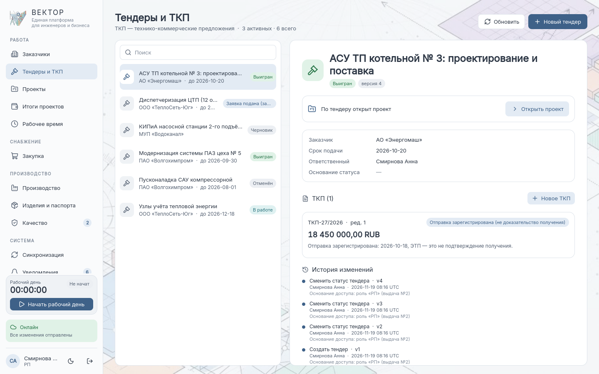
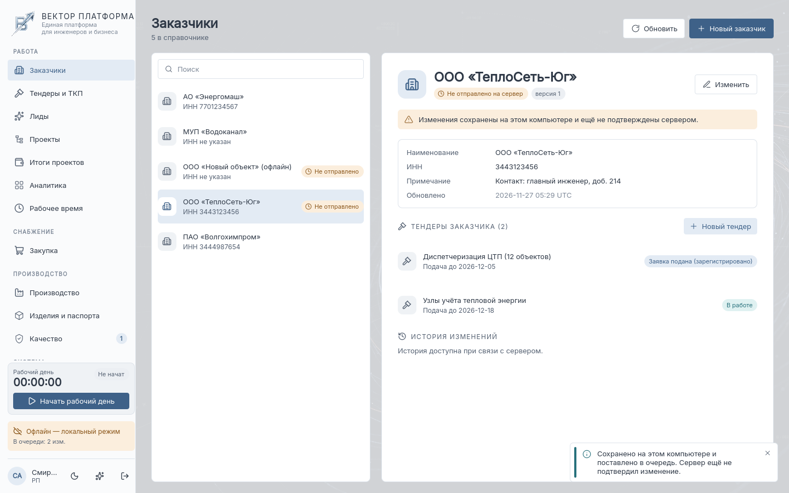
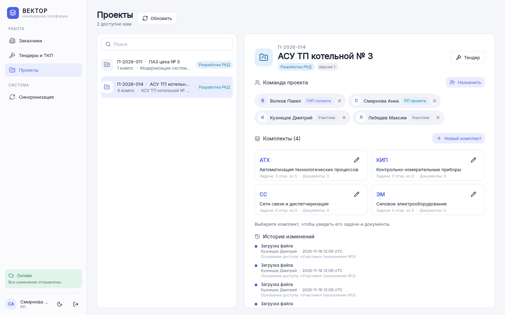
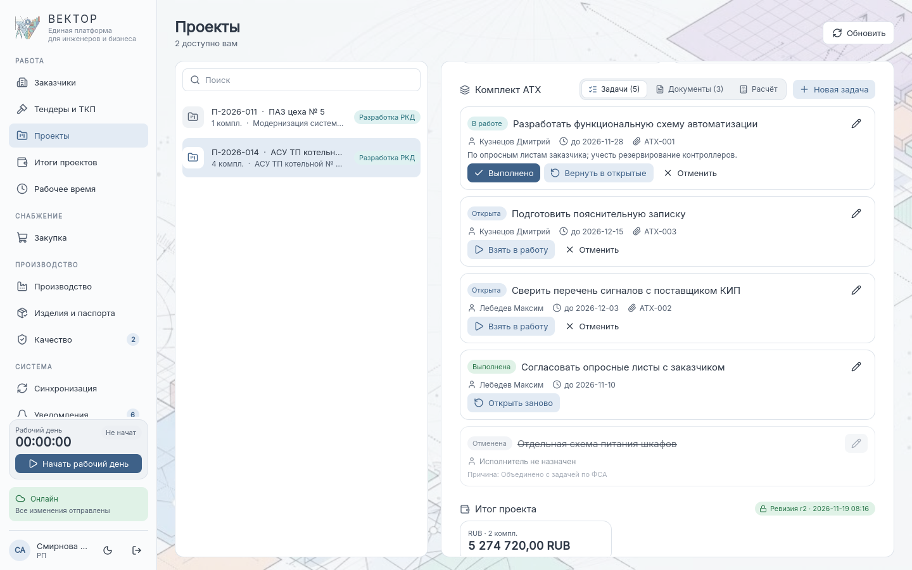
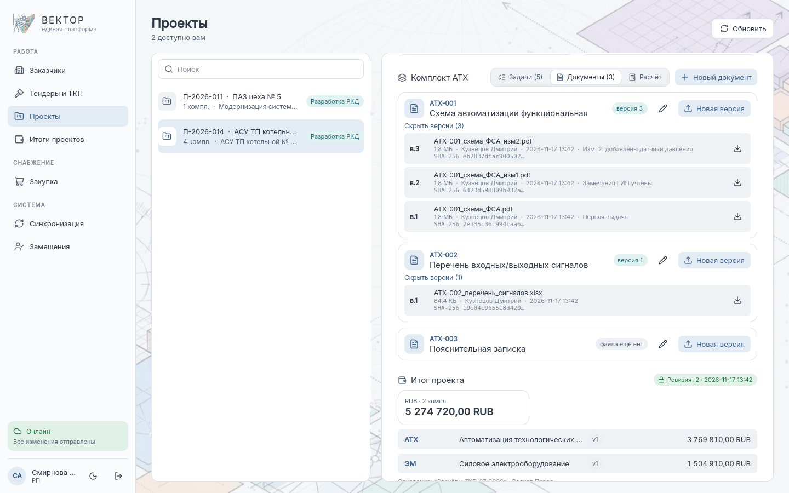
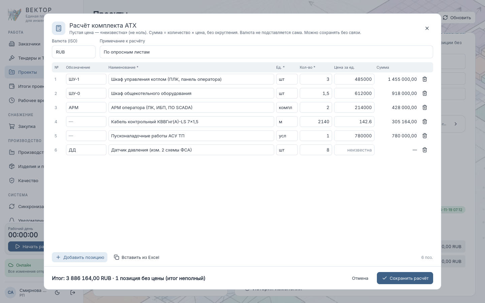
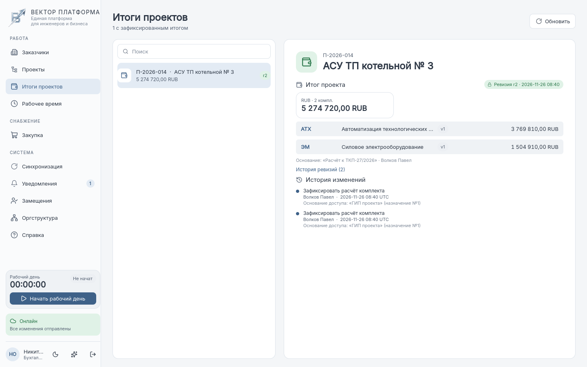
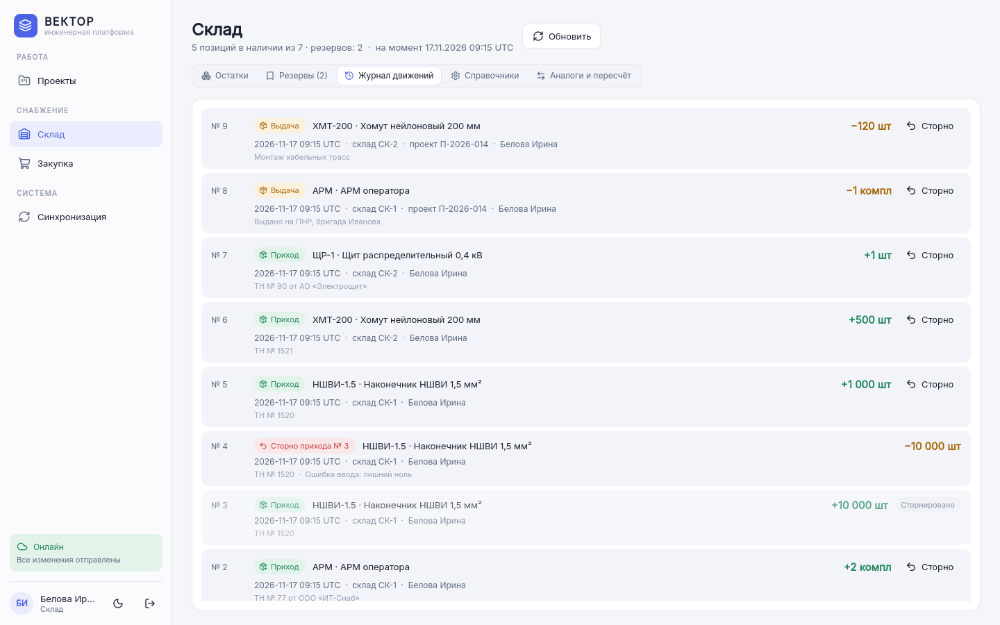
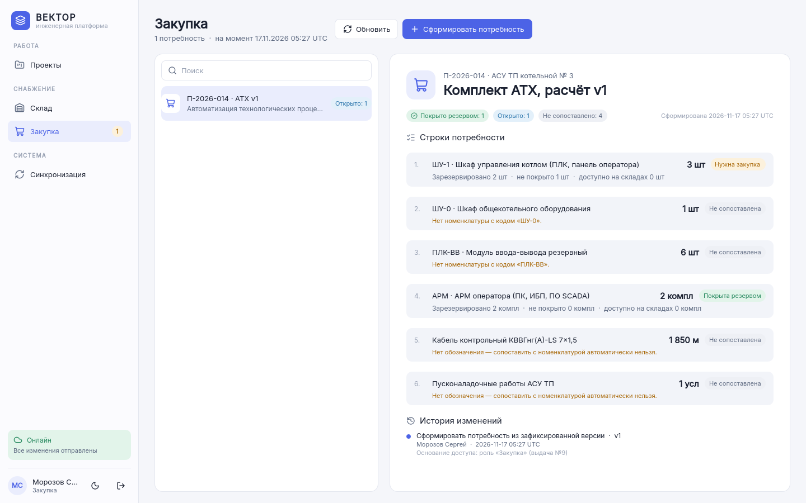
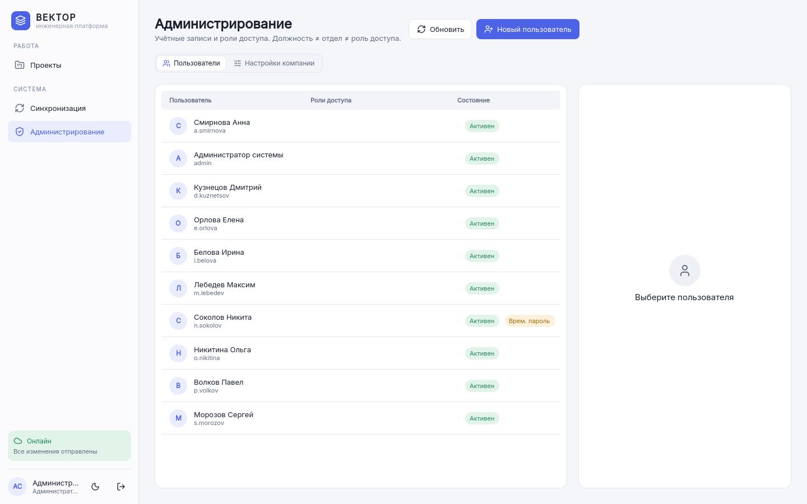

# Руководство пользователя ВЕКТОР (настольный клиент)

Версия программы: 0.2.0.dev0 (этапы 1–4 в разработке). Скриншоты — из настоящего интерфейса с вымышленными
демо-данными (`docs/screenshots`, светлая тема; в тёмной теме всё то же самое).

> Кому: всем сотрудникам, работающим в ВЕКТОР (РП, ГИП, руководители отделов, инженеры, склад, закупка,
> бухгалтерия). Администратору сервера — [admin-guide.md](admin-guide.md); кто что может —
> [reference.md](reference.md).

**Содержание.** 1. Главное за минуту · 2. Вход · 3. Экран и навигация · 4. Работа без связи ·
5. Синхронизация и конфликты · 6. Заказчики · 7. Тендеры и ТКП · 8. Проекты и команда ·
9. Комплект: задачи · 10. Комплект: документы и файлы · 11. Комплект: расчёт · 12. Итоги проектов ·
13. Склад · 14. Закупка · 15. Администрирование · 16. Горячие клавиши · 17. Сообщения и что делать ·
18. Вопросы и ответы

---

## 1. Главное за минуту

* **Сервер — главный.** Всё, что вы делаете, окончательно проверяет сервер компании: права, статус, версию объекта.
  Кнопки, которых у вас нет в интерфейсе, скрыты лишь для удобства — сервер всё равно не даст выполнить
  недоступное действие.
* **Можно работать без связи.** Данные, которые вы уже видели, хранятся на компьютере в зашифрованном виде.
  Часть действий (создать или изменить карточку, задачу, черновик расчёта) сохраняется в **очередь** и уходит
  на сервер, когда появится связь. Действия с финансовыми, складскими или юридическими последствиями
  (согласование, фиксация расчёта, проводки, загрузка файла) — **только при связи**: без неё программа честно
  откажет и ничего не поставит в очередь.
* **Ничего не перезаписывается молча.** Если коллега успел изменить тот же объект, вы увидите конфликт и сами
  решите: отменить своё изменение или применить его поверх новой версии.
* **«Неизвестно» ≠ 0.** Пустая цена, неизвестный остаток или неполный итог показываются явно («—»,
  «неизвестно», «итог неполный»), а не как ноль.

## 2. Вход

1. **Адрес сервера** — выдаёт администратор, например `https://vector.company.local:8443`. На тестовом стенде
   адрес подставлен ярлыком.
2. **Логин и пароль** — ваша учётная запись в ВЕКТОР (не учётная запись Windows).
3. **Дополнительно → файл сертификата** — нужен, только если сертификат сервера выдан внутренним центром
   сертификации компании, который не установлен в Windows. Файл (`ca.pem`) даёт администратор.
4. Нажмите **Войти** (или `Enter`).

Что важно:

* **Первый вход или после сброса пароля** — программа попросит сменить пароль (не короче 12 символов). Без
  смены работать нельзя. После смены другие ваши сеансы завершаются.
* **Неверный пароль** — сообщение одно и то же, без подсказки, что именно неверно (так безопаснее).
  После **5 неудачных попыток подряд** учётная запись блокируется на **15 минут**; раньше разблокировать может
  администратор (сбросом пароля).
* **Сеанс** завершается после **120 минут** бездействия (и не позже чем через 12 часов). Неотправленные
  изменения при этом не теряются — войдите снова.
* **Нет связи с сервером** — если вы уже входили на этом компьютере, откроется **офлайн-профиль** (см. § 4).
  Первый вход на новом компьютере требует связи.
* **«Сертификат сервера не прошёл проверку»** — это не «нет связи», а возможная подмена сервера или ошибка
  настройки. Не продолжайте; сообщите администратору.

## 3. Экран и навигация

* **Слева — разделы.** Видны только разделы, доступные вашей роли:
  * РАБОТА — Заказчики, Тендеры и ТКП, Проекты, Итоги проектов;
  * СНАБЖЕНИЕ — Склад, Закупка;
  * СИСТЕМА — Синхронизация (со счётчиком ожидающих изменений), Администрирование.
* **Слева внизу** — индикатор связи («Онлайн», «Офлайн — локальный режим», «Сервер доступен») с числом
  изменений в очереди и числом изменений, требующих решения; кнопка **Подключиться** (в офлайн-режиме); ваше
  имя и роли, переключатель светлой/тёмной темы (луна/солнце) и **Выйти**.
* **Над карточкой** — заголовок раздела и кнопки действий (**Обновить**, **Новый …**).
* **Списки и карточки.** Большинство разделов устроены одинаково: слева список с поиском, справа карточка
  выбранного объекта с действиями и **историей** (кто, когда и на каком основании что сделал).
* **Метки.** «Не отправлено» — изменение ещё в очереди; «Конфликт» — нужно ваше решение; цветные метки
  статусов («Черновик», «Выигран», «Действует» и т. п.).
* **Уведомления** появляются в правом нижнем углу и исчезают сами.

## 4. Работа без связи

Если сервер недоступен (нет сети, сервер остановлен), программа продолжает работать с локальной копией данных.

| Можно без связи | Только при связи |
|---|---|
| Просматривать всё, что уже загружено (на момент последнего обновления) | Согласовать ТКП, отметить отправку, начать РКД |
| Создавать и изменять заказчиков, тендеры, черновики ТКП, комплекты | Назначить участников проекта, администрирование |
| Создавать и изменять задачи и карточки документов | Загрузить или скачать файл версии документа |
| Сохранять черновик расчёта комплекта | Зафиксировать расчёт |
| Создавать склады и позиции номенклатуры | Приход, выдача, сторно, резерв, снятие резерва, формирование потребности |

Полный список — [reference.md, § 3](reference.md#3-команды-и-работа-без-связи).

* **Офлайн-вход** работает **7 дней** после последнего входа при связи, тем же паролем.
* Изменения из очереди помечены «Не отправлено»: это ещё **не подтверждённые** действия. Сервер проверит их
  заново при отправке и может отклонить (например, если за это время у вас отозвали права).
* Складские данные без связи показываются как снимок **«на момент …»** — остатки могли измениться.
* Когда сервер снова доступен, индикатор слева внизу сменится на «Сервер доступен» и появится уведомление;
  нажмите **Подключиться** (там же) и введите пароль — очередь отправится автоматически.

Локальные данные зашифрованы. Их нельзя прочитать без вашего пароля **и** вашей учётной записи Windows на этом
компьютере. Если администратор сбросил вам пароль, прежняя локальная копия становится недоступной: программа
откладывает её (не удаляет) и предупреждает, что неотправленные изменения из неё не отправлены. Поэтому перед
сбросом пароля по возможности синхронизируйтесь.

## 5. Синхронизация и конфликты

Раздел **Синхронизация** (`Ctrl+4`) показывает изменения, ещё не подтверждённые сервером, и изменения, которые
требуют вашего решения. Синхронизация идёт автоматически каждые 20 секунд при связи; вручную — кнопка
**Синхронизировать** или `F5`.

* Изменения отправляются **строго по порядку**. Если одно отклонено или в конфликте, следующие ждут — так
  сохраняется смысл последовательности (например, «создать заказчика» → «создать по нему тендер»).
* **Конфликт** — объект на сервере изменился после того, как вы начали правку. Программа показывает по полям
  «Моё изменение» и «Сейчас на сервере». Варианты:
  * **Отменить моё изменение** — на экране останется версия сервера;
  * **Применить поверх текущей версии** — ваши значения будут отправлены как новое изменение к актуальной
    версии (вы сознательно заменяете изменения коллеги в этих полях).
  Автоматического «слияния» нет — это решение владельца продукта.
* **Отказ** (например, «нет права», «неверный ИНН») — прочитайте причину, исправьте и повторите или отмените.
* **«Ответ сервера не получен: результат неизвестен»** — запрос ушёл, но ответ потерялся. Нажмите
  **Синхронизировать** (`F5`): программа спросит сервер по тому же номеру операции. Действие **не выполнится
  дважды** — сервер либо выполнит его впервые, либо вернёт уже сохранённый результат.

## 6. Заказчики

Кто: ГИП, РП, руководитель отдела создают и меняют; ведущий инженер и бухгалтерия — просматривают.

* **Новый заказчик**: наименование (обязательно), ИНН (10 или 12 цифр; контрольная сумма пока не проверяется),
  примечание. Можно без связи.
* В карточке — тендеры заказчика; отсюда же можно создать новый тендер.

## 7. Тендеры и ТКП

**Тендер** проходит статусы: Черновик → В работе → Заявка подана → Выигран / Проигран; «Отменён» — из любого
незавершённого. Для «Проигран» и «Отменён» нужна причина. Схема переходов — [reference.md, § 4](reference.md#тендер).

**ТКП** (технико-коммерческое предложение) принадлежит тендеру:

1. **Новое ТКП** — название, сумма и валюта. Сумма вводится как в Excel: `1 250 000,50`; допускается не больше
   4 знаков после запятой. Пустая сумма — «Сумма не указана» (это не ноль).
2. **Согласовать** — ГИП или руководитель отдела, **только при связи**. Автор последней правки не может
   согласовать своё ТКП сам (разделение обязанностей).
3. **Отметить отправку** — регистрация факта отправки заказчику (не доказательство получения).
4. **Вернуть в черновик** — если нужно изменить согласованное ТКП (согласование придётся повторить).

**Начать РКД.** Когда тендер в статусе **«Выигран»**, РП или ГИП нажимает **Начать РКД**: указывает шифр и
название проекта. Так создаётся проект — только явным действием, только из выигранного тендера, один проект на
тендер. Требует связи.

## 8. Проекты и команда

Карточка проекта: тендер-основание, **команда**, **комплекты**, **итог проекта** (для ГИП, РП и бухгалтерии) и
история.

* **Команда.** ГИП проекта назначает только администратор. РП назначает администратор или ГИП проекта;
  участников — ГИП или РП проекта. Назначение можно отозвать; повторное назначение — новая запись, прежние
  согласования «не оживают».
* **Комплекты** (марки: АТХ, ЭМ и т. д.) создают ГИП и РП проекта. Выберите комплект — ниже откроется рабочая
  область с вкладками **Задачи**, **Документы**, **Расчёт**.
* Документы, задачи и расчёты проекта видят только его команда и руководство с соответствующими ролями.

## 9. Комплект: задачи

* Задачи создают и назначают ГИП и РП проекта. Исполнитель — только участник проекта с действующим назначением.
  Можно указать срок и связать задачу с документом (замечание к документу).
* Статусы: Открыта → В работе → Выполнена; «Отменена» — с причиной. Возврат выполненной задачи в работу — тоже
  с причиной.
* **Исполнитель** сам переводит **свою** задачу: Открыта → В работе → Выполнена (или обратно в «Открыта»).
* Можно без связи (через очередь).

## 10. Комплект: документы и файлы

* **Документ** — карточка с обозначением (уникально в проекте) и названием. Создать и изменить карточку можно
  без связи.
* **Новая версия** — загрузка файла. Только при связи. Каждая версия **неизменяема**: имя файла, размер и
  контрольная сумма SHA-256 фиксируются при загрузке; исправление — это новая версия с номером n+1.
* **Размер файла** — до 200 МБ (предел задаёт администратор). Слишком большой файл отклоняется сразу, до
  передачи.
* **Скачать** — файл сохраняется в выбранное место **только после проверки контрольной суммы**. Если файл
  повредился в пути, программа сообщит об этом и не оставит повреждённую копию.
* Файлы не хранятся в локальной копии: их скачивают явно, по команде.

## 11. Комплект: расчёт

Расчёт комплекта — список позиций (обозначение, наименование, единица, количество, цена за единицу).

1. **Черновик** правят участники проекта; можно без связи (сохраняется через очередь).
2. **Редактор позиций** проверяет ввод «на лету»: количество > 0, цена ≥ 0 или пусто, не больше 4 знаков после
   запятой. Пустая цена — «неизвестна»; итог с такими позициями помечается **«итог неполный»**. Позиции можно
   вставить из Excel.

   

3. **Зафиксировать** — ГИП проекта, только при связи, с указанием причины. Получается неизменяемая версия
   (v1, v2, …) с контрольной суммой содержимого, а проект получает новую **ревизию итога**.
4. **Сравнение** с зафиксированной версией: добавленные, изменённые и удалённые позиции, разница итога (или
   «неизвестна», если есть позиции без цены или сменилась валюта).

   

**Официальный итог проекта** складывается **только из зафиксированных версий** комплектов. Черновики в него не
входят. Итоги в разных валютах не суммируются.

## 12. Итоги проектов

Раздел для бухгалтерии (и ГИП/РП своих проектов): последняя ревизия итога каждого проекта, её состав
(«АТХ v1, ЭМ v1»), итоги по валютам и история ревизий. Черновики и отдельные позиции здесь не показываются.
Фактическая себестоимость пока недоступна (ждёт решения владельца).

## 13. Склад

Кто: склад (все операции), закупка (просмотр, номенклатура). Без связи — только просмотр снимка «на момент …» и
новые склады/позиции номенклатуры через очередь.

* **Остатки** по позициям и складам: остаток, в резерве, **доступно = остаток − резерв**. Состояния: «Нет на
  складе», «Всё в резерве», «Есть резерв», «Свободно».
* **Приход** — склад, позиция, количество (> 0, не больше 4 знаков после запятой) и **основание** (накладная,
  акт — обязательно).
* **Выдача на проект** — из доступного количества или из резерва проекта; причина обязательна.
* **Резерв** за проектом — только из доступного; можно привязать к строке потребности (не больше непокрытого
  количества). **Снять резерв** — с причиной, неизрасходованная часть возвращается в доступное.
* **Сторно** — исправление ошибочной проводки встречной записью «Сторно прихода/выдачи № N». Исходная запись
  остаётся в журнале с пометкой «Сторнировано»; повторно сторнировать нельзя. Сторно прихода невозможно, если
  товар уже зарезервирован или выдан.
* **Журнал движений** — все проводки с номерами, основаниями и авторами.

  

* **Справочники**: склады (код, название; отключённый склад не принимает приход и резерв) и номенклатура (код,
  наименование, единица; единицу нельзя менять, если по позиции уже были движения).
* **Аналоги и пересчёт** (склад и закупка, только при связи):

  

  * **Другие обозначения** — как позицию называют в расчётах и ТКП (например, «ХС-200» для «ХМТ-200»). Если в
    строке расчёта стоит такое обозначение **и единица совпадает** с единицей позиции, потребность сопоставит
    строку автоматически, с пометкой «по другому обозначению». Обозначение уникально и не может совпадать с кодом
    другой позиции. Позицию у обозначения не меняют — отключите его и заведите новое (история сохраняется).
  * **Пересчёт единиц** — «1 [из] = [коэффициент] [в]», например «1 км = 1000 м» (общий, для любой позиции в
    метрах) или «1 бухта = 100 м» (только для конкретного кабеля). Коэффициент больше нуля, не больше 4 знаков
    после запятой. Обратный пересчёт сам не создаётся. Пересчёт **не применяется автоматически** — только при
    ручном сопоставлении, когда закупка видит и подтверждает коэффициент. Изменение коэффициента не трогает уже
    принятые решения.

## 14. Закупка

* **Сформировать потребность** — закупка явным действием по **последней зафиксированной версии** расчёта
  комплекта (только при связи). Строки — без цен. Строка сопоставляется с номенклатурой автоматически, если
  обозначение совпало с кодом позиции или с её **другим обозначением** («Склад» → «Аналоги и пересчёт») **и**
  совпала единица; иначе — «Не сопоставлена» с причиной. По одной версии потребность формируется один раз.
* **Сопоставить вручную** (только закупка, только при связи). Если строка «Не сопоставлена» (нет обозначения, нет
  такой позиции, другая единица), нажмите **Сопоставить** у строки, выберите позицию номенклатуры и напишите, почему
  она подходит. В списке — действующие позиции **с той же единицей** и позиции, для которых в справочнике есть
  **пересчёт** из единицы строки. У такой позиции показано правило и результат, например «1 км = 1000 м: 1,85 км =
  1850 м»; кнопка называется «Сопоставить с пересчётом». Если результат получается больше чем с 4 знаками после
  запятой, выбрать позицию нельзя — программа не округляет количество за вас. Если позиции нет — заведите её
  («Склад» → «Справочники») или пересчёт («Склад» → «Аналоги и пересчёт»).
* **Коэффициент фиксируется в решении.** Резерв и покрытие строки дальше считаются в единицах позиции (под строкой
  написано «В единицах позиции: 1850 м»). Если коэффициент в справочнике успели изменить, пока вы смотрели форму,
  программа откажет («пересчёт изменили») — обновите данные и подтвердите новое число.

  

  После этого под строкой написано «Сопоставлена вручную: <причина>», и склад может резервировать под неё. Решение
  можно поменять (**Изменить**). Если под строку уже есть резервы, действует настройка компании «Пересопоставление
  при резервах» (её задаёт администратор, § 15): **«Запрещено»** (так и тогда, когда настройка не задана) — сначала
  склад снимает резервы; **«Снимать действующие резервы»** — резервы снимутся сами с вашей причиной, но только если у
  вас есть право снимать резервы (роль «Склад»); иначе попросите склад. Если по строке уже **выдано** со склада,
  сменить позицию нельзя при любой настройке. Все
  решения сохраняются в «Истории изменений» потребности — прежние не стираются. Если коллега одновременно
  изменил ту же потребность, программа сообщит о конфликте: обновите данные и повторите.
* **Покрытие**: для каждой строки — требуется, в резерве, осталось покрыть, доступно на складе.
* Склад резервирует под строку кнопкой **Зарезервировать** (не больше непокрытого).
* ГИП и РП видят потребность **своего** проекта; доступное количество для них — «неизвестно» (у них нет прав на
  складские данные), а не ноль.

## 15. Администрирование

Только для роли «Администратор». Администратор управляет учётными записями, но **не получает** бизнес-прав
(не видит заказчиков, проекты, склад, если ему не выданы соответствующие роли).

* **Новый пользователь** — логин, имя, временный пароль; пользователь сменит его при первом входе.
* **Выдать роль / Отозвать** — с причиной. Отзыв действует сразу, в том числе для изменений, ожидающих в
  очереди у пользователя.
* **Отключить / Включить учётную запись** — отключённый пользователь не может войти, его сеансы завершаются. Нельзя отключить
  себя и последнего действующего администратора.
  Метка «Блок.» в списке означает временную блокировку после неудачных попыток входа.
* **Сбросить пароль** — временный пароль, снимает блокировку после неудачных попыток, завершает все сеансы.
* **Завершить все сеансы** пользователя (например, при утере ноутбука).
* **Настройки компании** (вкладка) — правила работы, которые меняет только администратор, при связи, с причиной.
  У каждой настройки видно действующее значение, кто, когда и почему его задал. «Не задано» означает, что
  действует самое строгое значение. Каждое изменение — новая версия; откат — публикация прежнего значения.
  Сейчас одна настройка — «Пересопоставление при резервах» (§ 14). Остальные пользователи видят эти правила
  в подсказках там, где они действуют.

  

Подробнее — [admin-guide.md, § 7](admin-guide.md#7-пользователи-роли-и-доступ).

## 16. Горячие клавиши

| Клавиши | Действие |
|---|---|
| `Ctrl+1` / `Ctrl+2` / `Ctrl+3` | Заказчики / Тендеры и ТКП / Проекты |
| `Ctrl+4` | Синхронизация |
| `Ctrl+5` / `Ctrl+6` | Склад / Закупка (если доступны) |
| `F5` | Синхронизировать сейчас |
| `Tab` / `Shift+Tab` | Переход между полями и кнопками |
| `Enter` | Вход; подтверждение в форме |
| `Пробел` / `Enter` на вкладке | Выбрать вкладку |

## 17. Сообщения и что делать

| Сообщение | Что значит | Что делать |
|---|---|---|
| «Сохранено на этом компьютере и поставлено в очередь…» | Нет связи или ждём ответа сервера | Ничего; уйдёт само при связи |
| «…требует актуальной проверки сервера… не выполнено и не поставлено в очередь» | Действие только при связи | Повторите, когда появится связь |
| «Сначала синхронизируйте или разрешите ожидающие изменения» | В очереди есть неотправленное | Раздел «Синхронизация» |
| «Ответ сервера не получен: результат неизвестен» | Ответ потерян | «Синхронизировать» (`F5`) — повтор безопасен |
| «Объект изменён другим пользователем» (конфликт) | Коллега успел изменить | Решите в «Синхронизации» (§ 5) |
| «Нет права…» | Роль не позволяет | Обратитесь к руководителю/администратору |
| «Учётная запись временно заблокирована…» | 5 неудачных входов | Подождите 15 минут или к администратору |
| «Офлайн-работа доступна не дольше 7 дн.…» | Давно не было входа при связи | Подключитесь к сети компании |
| «Сертификат сервера не прошёл проверку» | Возможна подмена/ошибка настройки | Не продолжайте, к администратору |
| «Файл больше допустимого размера (N МБ)» | Предел сервера | Уменьшите файл или к администратору |
| «Файл повреждён при передаче… (контрольная сумма не совпала)» | Сбой сети | Повторите загрузку/скачивание |
| «Не более 4 знаков после запятой» | Ограничение точности | Округлите значение сами |
| «Локальные данные повреждены или изменены вне программы» | Локальная копия испорчена | К администратору: очистка локального кэша (неотправленное будет потеряно) |

## 18. Вопросы и ответы

**Почему я не вижу раздел/кнопку?** Нет нужной роли или назначения в проекте. Состав прав —
[reference.md](reference.md).

**Почему число «доступно» другое, чем у коллеги?** Без связи вы видите снимок «на момент …». Нажмите `F5`.

**Можно ли вернуть удалённую/исправленную версию документа?** Версии не удаляются и не меняются — все прежние
версии доступны для скачивания.

**Почему итог проекта не изменился после правки расчёта?** Итог считается только из **зафиксированных** версий.
Попросите ГИП зафиксировать расчёт.

**Где хранятся мои данные?** На сервере компании. На компьютере — зашифрованная рабочая копия
(`%LOCALAPPDATA%\VECTOR\profiles`), которую нельзя открыть без вашего пароля и вашей учётной записи Windows.
