# Руководство пользователя ВЕКТОР (настольный клиент)

Версия программы: 0.2.0.dev0 (этапы 1–5 в разработке). Скриншоты — из настоящего интерфейса с вымышленными
демо-данными (`docs/screenshots`, светлая тема; в тёмной теме всё то же самое).

> Кому: всем сотрудникам, работающим в ВЕКТОР (руководители проектов — РП, главные инженеры проектов — ГИП,
> руководители отделов, инженеры, технологи, производство, склад, закупка, бухгалтерия). Администратору сервера — [admin-guide.md](admin-guide.md); кто что может —
> [reference.md](reference.md).

**Содержание.** 1. Главное за минуту · 2. Вход · 3. Экран и навигация · 4. Работа без связи ·
5. Синхронизация и конфликты · 6. Заказчики · 7. Тендеры и ТКП · 8. Проекты и команда ·
9. Комплект: задачи · 10. Комплект: документы и файлы · 11. Комплект: расчёт · 12. Итоги проектов ·
13. Склад · 14. Закупка · 15. Производство · 16. Рабочее время · 17. Администрирование · 18. Горячие клавиши ·
19. Сообщения и что делать · 20. Вопросы и ответы · 21. Сокращения и подсказки

> **Основные сокращения** (полный список — § 21, в программе — клавиша `F1`):
> **ТКП** — технико-коммерческое предложение; **РКД** — рабочая конструкторская документация;
> **ГИП** — главный инженер проекта; **РП** — руководитель проекта; **ТП** — технологический процесс;
> **НДС** — налог на добавленную стоимость; **ИНН / КПП / ОГРН / БИК** — реквизиты организации и банка;
> **SHA-256** — контрольная сумма («отпечаток») файла или снимка; **АТХ, ЭМ** — марки комплектов рабочей
> документации (автоматизация технологических процессов, силовое электрооборудование).

---

## 1. Главное за минуту

* **Сервер — главный.** Всё, что вы делаете, окончательно проверяет сервер компании: права, статус, версию объекта.
  Кнопки, которых у вас нет в интерфейсе, скрыты лишь для удобства — сервер всё равно не даст выполнить
  недоступное действие.
* **Можно работать без связи.** Данные, которые вы уже видели, хранятся на компьютере в зашифрованном виде.
  Часть действий (создать или изменить карточку, задачу, черновик расчёта, заказа поставщику или техпроцесса, договор
  поставщика, отметки исполнителя «Начать / Пауза / Завершить» по операции наряда) сохраняется в **очередь** и уходит
  на сервер, когда появится связь. Действия с финансовыми, складскими или юридическими последствиями
  (согласование, фиксация расчёта, проводки, загрузка файла) — **только при связи**: без неё программа честно
  откажет и ничего не поставит в очередь.
* **Ничего не перезаписывается молча.** Если коллега успел изменить тот же объект, вы увидите конфликт и сами
  решите: отменить своё изменение или применить его поверх новой версии.
* **«Неизвестно» ≠ 0.** Пустая цена, неизвестный остаток или неполный итог показываются явно («—»,
  «неизвестно», «итог неполный»), а не как ноль.

## 2. Вход

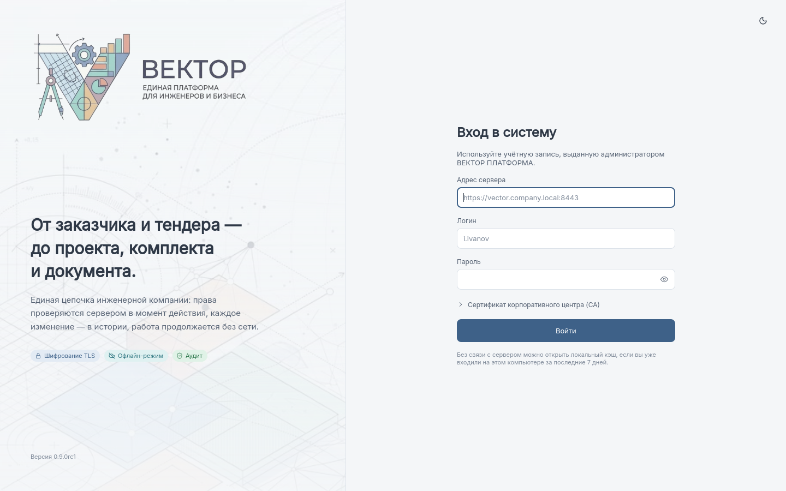

1. **Адрес сервера** — выдаёт администратор, например `https://vector.company.local:8443`. На тестовом стенде
   адрес подставлен ярлыком.
2. **Логин и пароль** — ваша учётная запись в ВЕКТОР (не учётная запись Windows).
3. **Дополнительно → файл сертификата** — нужен, только если сертификат сервера выдан внутренним центром
   сертификации компании, который не установлен в Windows. Файл (`ca.pem`) даёт администратор.
4. Нажмите **Войти** (или `Enter`).

Что важно:

* **Первый вход или после сброса пароля** — программа попросит сменить пароль (не короче 12 символов). Без
  смены работать нельзя. После смены другие ваши сеансы завершаются.
* **Неверный пароль** — сообщение одно и то же, без подсказки, что именно неверно (так безопаснее).
  После **5 неудачных попыток подряд** учётная запись блокируется на **15 минут**; раньше разблокировать может
  администратор (сбросом пароля).
* **Сеанс** завершается после **120 минут** бездействия (и не позже чем через 12 часов). Неотправленные
  изменения при этом не теряются — войдите снова.
* **Нет связи с сервером** — если вы уже входили на этом компьютере, откроется **офлайн-профиль** (см. § 4).
  Первый вход на новом компьютере требует связи.
* **«Сертификат сервера не прошёл проверку»** — это не «нет связи», а возможная подмена сервера или ошибка
  настройки. Не продолжайте; сообщите администратору.

## 3. Экран и навигация

* **Слева — разделы.** Видны только разделы, доступные вашей роли:
  * РАБОТА — Заказчики, Тендеры и ТКП, Проекты, Итоги проектов, **Рабочее время** (§ 16, у всех; счётчик —
    отчёты на проверке у руководителя отдела или ваши возвращённые);
  * СНАБЖЕНИЕ — Склад, Закупка;
  * ПРОИЗВОДСТВО — Производство (§ 15; со счётчиком ваших операций к выполнению);
  * СИСТЕМА — Синхронизация (со счётчиком ожидающих изменений), Уведомления (§ 14.5, со счётчиком
    непрочитанных), Замещения (§ 14.4), **Сокращения и подсказки** (§ 21, клавиша `F1`), Администрирование.
* **Слева внизу** — индикатор связи («Онлайн», «Офлайн — локальный режим», «Сервер доступен») с числом
  изменений в очереди и числом изменений, требующих решения; кнопка **Подключиться** (в офлайн-режиме); ваше
  имя и роли, переключатель светлой/тёмной темы (луна/солнце) и **Выйти**.
* **Над карточкой** — заголовок раздела и кнопки действий (**Обновить**, **Новый …**).
* **Списки и карточки.** Большинство разделов устроены одинаково: слева список с поиском, справа карточка
  выбранного объекта с действиями и **историей** (кто, когда и на каком основании что сделал).
* **Метки.** «Не отправлено» — изменение ещё в очереди; «Конфликт» — нужно ваше решение; цветные метки
  статусов («Черновик», «Выигран», «Действует» и т. п.).
* **Подсказки при наведении мыши.** Задержите указатель на кнопке, пункте меню, вкладке, метке статуса или подписи
  поля на полсекунды — появится пояснение: что сделает действие, нужна ли связь и расшифровка сокращений (§ 21).
* **Всплывающие сообщения** появляются в правом нижнем углу и исчезают сами (результат действия; о новых
  уведомлениях — «Уведомление: …», § 14.5).

## 4. Работа без связи

Если сервер недоступен (нет сети, сервер остановлен), программа продолжает работать с локальной копией данных.

| Можно без связи | Только при связи |
|---|---|
| Просматривать всё, что уже загружено (на момент последнего обновления) | Согласовать ТКП, отметить отправку, начать РКД |
| Создавать и изменять заказчиков, тендеры, черновики ТКП, комплекты | Назначить участников проекта, администрирование |
| Создавать и изменять задачи и карточки документов | Загрузить или скачать файл версии документа |
| Сохранять черновик расчёта комплекта | Зафиксировать расчёт |
| Создавать склады и позиции номенклатуры | Приход, выдача, сторно, резерв, снятие резерва, формирование потребности |
| Черновик техпроцесса; отметки по своей операции наряда (таймер идёт по часам компьютера) | Утвердить ТП, выпустить / назначить / закрыть / отменить наряд, замена в наряде |

Полный список — [reference.md, § 3](reference.md#3-команды-и-работа-без-связи).

* **Офлайн-вход** работает **7 дней** после последнего входа при связи, тем же паролем.
* Изменения из очереди помечены «Не отправлено»: это ещё **не подтверждённые** действия. Сервер проверит их
  заново при отправке и может отклонить (например, если за это время у вас отозвали права).
* Складские данные без связи показываются как снимок **«на момент …»** — остатки могли измениться.
* Когда сервер снова доступен, индикатор слева внизу сменится на «Сервер доступен» и появится уведомление;
  нажмите **Подключиться** (там же) и введите пароль — очередь отправится автоматически.

Локальные данные зашифрованы. Их нельзя прочитать без вашего пароля **и** вашей учётной записи Windows на этом
компьютере. Если администратор сбросил вам пароль, прежняя локальная копия становится недоступной: программа
откладывает её (не удаляет) и предупреждает, что неотправленные изменения из неё не отправлены. Поэтому перед
сбросом пароля по возможности синхронизируйтесь.

## 5. Синхронизация и конфликты

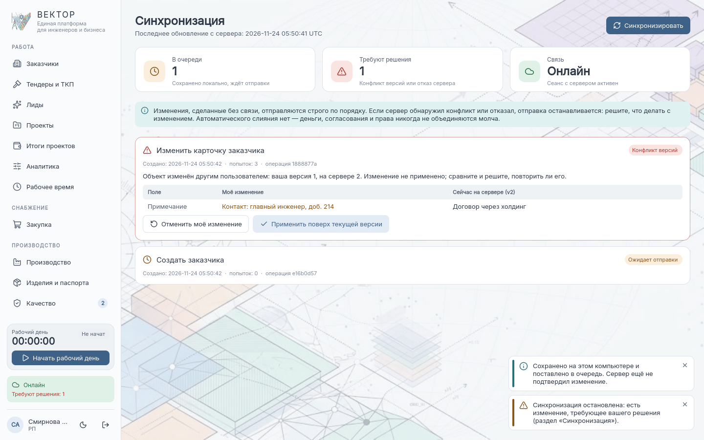

Раздел **Синхронизация** (`Ctrl+4`) показывает изменения, ещё не подтверждённые сервером, и изменения, которые
требуют вашего решения. Синхронизация идёт автоматически каждые 20 секунд при связи; вручную — кнопка
**Синхронизировать** или `F5`.

* Изменения отправляются **строго по порядку**. Если одно отклонено или в конфликте, следующие ждут — так
  сохраняется смысл последовательности (например, «создать заказчика» → «создать по нему тендер»).
* **Конфликт** — объект на сервере изменился после того, как вы начали правку. Программа показывает по полям
  «Моё изменение» и «Сейчас на сервере». Варианты:
  * **Отменить моё изменение** — на экране останется версия сервера;
  * **Применить поверх текущей версии** — ваши значения будут отправлены как новое изменение к актуальной
    версии (вы сознательно заменяете изменения коллеги в этих полях).
  Автоматического «слияния» нет — это решение владельца продукта.
* **Отказ** (например, «нет права», «неверный ИНН») — прочитайте причину, исправьте и повторите или отмените.
* **«Ответ сервера не получен: результат неизвестен»** — запрос ушёл, но ответ потерялся. Нажмите
  **Синхронизировать** (`F5`): программа спросит сервер по тому же номеру операции. Действие **не выполнится
  дважды** — сервер либо выполнит его впервые, либо вернёт уже сохранённый результат.

## 6. Заказчики

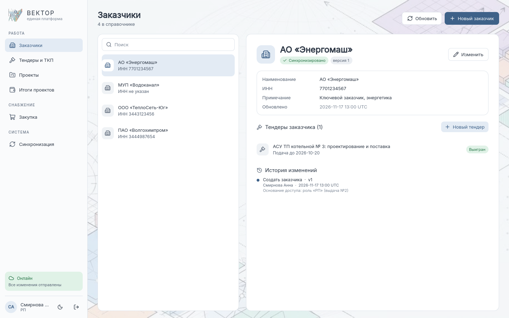

Кто: ГИП, РП, руководитель отдела создают и меняют; ведущий инженер и бухгалтерия — просматривают.

* **Новый заказчик**: наименование (обязательно), ИНН (10 или 12 цифр; контрольная сумма пока не проверяется),
  примечание. Можно без связи.
* В карточке — тендеры заказчика; отсюда же можно создать новый тендер.

## 7. Тендеры и ТКП

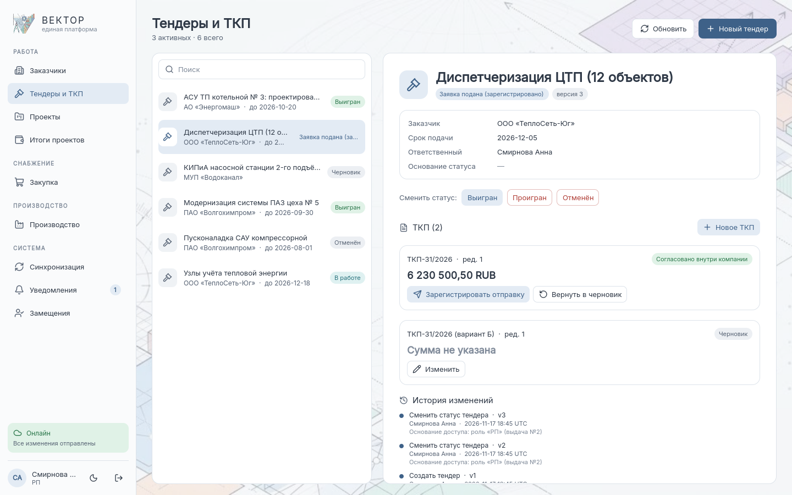

**Тендер** проходит статусы: Черновик → В работе → Заявка подана → Выигран / Проигран; «Отменён» — из любого
незавершённого. Для «Проигран» и «Отменён» нужна причина. Схема переходов — [reference.md, § 4](reference.md#тендер).

**ТКП** (технико-коммерческое предложение) принадлежит тендеру:

1. **Новое ТКП** — название, сумма и валюта. Сумма вводится как в Excel: `1 250 000,50`; допускается не больше
   4 знаков после запятой. Пустая сумма — «Сумма не указана» (это не ноль).
2. **Согласовать** — ГИП или руководитель отдела, **только при связи**. Автор последней правки не может
   согласовать своё ТКП сам (разделение обязанностей).
3. **Отметить отправку** — регистрация факта отправки заказчику (не доказательство получения).
4. **Вернуть в черновик** — если нужно изменить согласованное ТКП (согласование придётся повторить).

**Начать РКД.** Когда тендер в статусе **«Выигран»**, РП или ГИП нажимает **Начать РКД**: указывает шифр и
название проекта. Так создаётся проект — только явным действием, только из выигранного тендера, один проект на
тендер. Требует связи.

## 8. Проекты и команда

Карточка проекта: тендер-основание, **команда**, **комплекты**, **итог проекта** (для ГИП, РП и бухгалтерии) и
история.

* **Команда.** ГИП проекта назначает только администратор. РП назначает администратор или ГИП проекта;
  участников — ГИП или РП проекта. Назначение можно отозвать; повторное назначение — новая запись, прежние
  согласования «не оживают».
* **Замещение в проекте.** Если ГИП, РП или участник передал свою роль в проекте на время (§ 14.4), под командой
  видна строка «Лебедев Максим — ГИП проекта, замещает Волков Павел до 23.11.2026». Замещающему участника можно
  назначить задачи; задачи самого участника замещающий ведёт за него.

  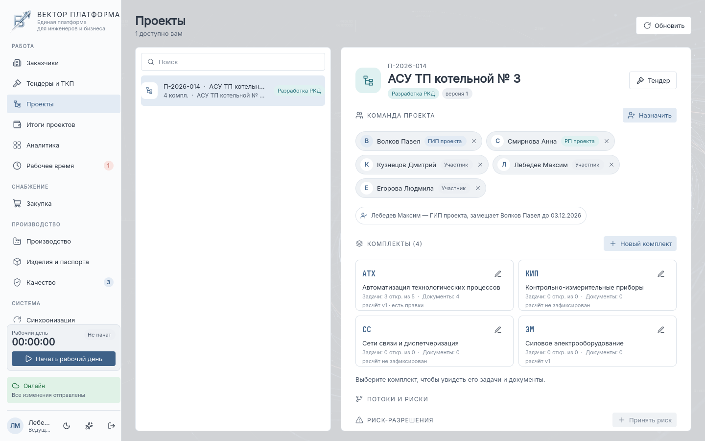
* **Комплекты** (марки: АТХ, ЭМ и т. д.) создают ГИП и РП проекта. Выберите комплект — ниже откроется рабочая
  область с вкладками **Задачи**, **Документы**, **Расчёт**.
* Документы, задачи и расчёты проекта видят только его команда и руководство с соответствующими ролями.

## 9. Комплект: задачи

* Задачи создают и назначают ГИП и РП проекта. Исполнитель — только участник проекта с действующим назначением.
  Можно указать срок и связать задачу с документом (замечание к документу).
* Статусы: Открыта → В работе → Выполнена; «Отменена» — с причиной. Возврат выполненной задачи в работу — тоже
  с причиной.
* **Исполнитель** сам переводит **свою** задачу: Открыта → В работе → Выполнена (или обратно в «Открыта»).
* Можно без связи (через очередь).

## 10. Комплект: документы и файлы

* **Документ** — карточка с обозначением (уникально в проекте) и названием. Создать и изменить карточку можно
  без связи.
* **Новая версия** — загрузка файла. Только при связи. Каждая версия **неизменяема**: имя файла, размер и
  контрольная сумма SHA-256 фиксируются при загрузке; исправление — это новая версия с номером n+1.
* **Размер файла** — до 200 МБ (предел задаёт администратор). Слишком большой файл отклоняется сразу, до
  передачи.
* **Скачать** — файл сохраняется в выбранное место **только после проверки контрольной суммы**. Если файл
  повредился в пути, программа сообщит об этом и не оставит повреждённую копию.
* Файлы не хранятся в локальной копии: их скачивают явно, по команде.

## 11. Комплект: расчёт

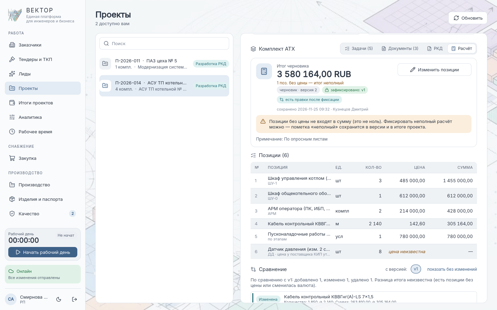

Расчёт комплекта — список позиций (обозначение, наименование, единица, количество, цена за единицу).

1. **Черновик** правят участники проекта; можно без связи (сохраняется через очередь).
2. **Редактор позиций** проверяет ввод «на лету»: количество > 0, цена ≥ 0 или пусто, не больше 4 знаков после
   запятой. Пустая цена — «неизвестна»; итог с такими позициями помечается **«итог неполный»**. Позиции можно
   вставить из Excel.

   

3. **Зафиксировать** — ГИП проекта, только при связи, с указанием причины. Получается неизменяемая версия
   (v1, v2, …) с контрольной суммой содержимого, а проект получает новую **ревизию итога**.
4. **Сравнение** с зафиксированной версией: добавленные, изменённые и удалённые позиции, разница итога (или
   «неизвестна», если есть позиции без цены или сменилась валюта).

   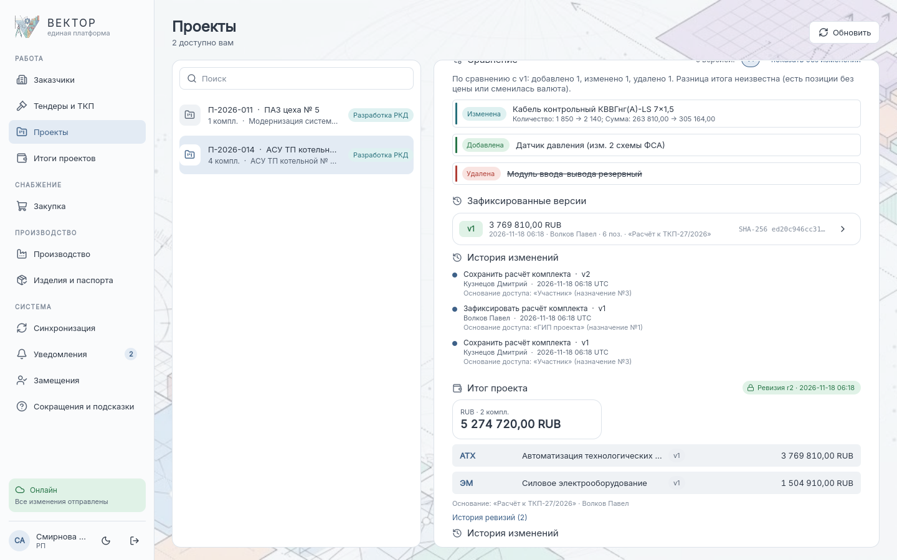

**Официальный итог проекта** складывается **только из зафиксированных версий** комплектов. Черновики в него не
входят. Итоги в разных валютах не суммируются.

## 12. Итоги проектов

Раздел для бухгалтерии (и ГИП/РП своих проектов): последняя ревизия итога каждого проекта, её состав
(«АТХ v1, ЭМ v1»), итоги по валютам и история ревизий. Черновики и отдельные позиции здесь не показываются.
Фактическая себестоимость пока недоступна (ждёт решения владельца).

## 13. Склад

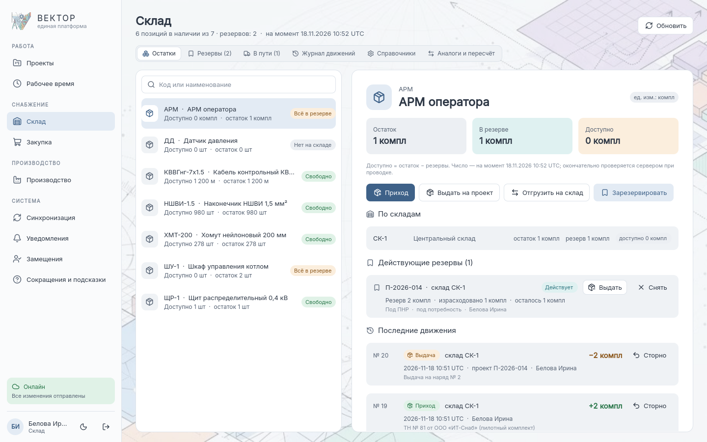

Кто: склад (все операции), закупка (просмотр, номенклатура). Без связи — только просмотр снимка «на момент …» и
новые склады/позиции номенклатуры через очередь.

* **Остатки** по позициям и складам: остаток, в резерве, **доступно = остаток − резерв**. Состояния: «Нет на
  складе», «Всё в резерве», «Есть резерв», «Свободно».
* **Приход** — склад, позиция, количество (> 0, не больше 4 знаков после запятой) и **основание** (накладная,
  акт — обязательно).
* **Выдача на проект** — из доступного количества или из резерва проекта; причина обязательна.
* **Резерв** за проектом — только из доступного; можно привязать к строке потребности (не больше непокрытого
  количества). **Снять резерв** — с причиной, неизрасходованная часть возвращается в доступное.
* **Перемещение между складами** — в два шага: склад-отправитель **отгружает**, склад-получатель **принимает**
  (D-29). Нужно минимум два действующих склада.
  1. **Отгрузить на склад** (кнопка у выбранной позиции):

     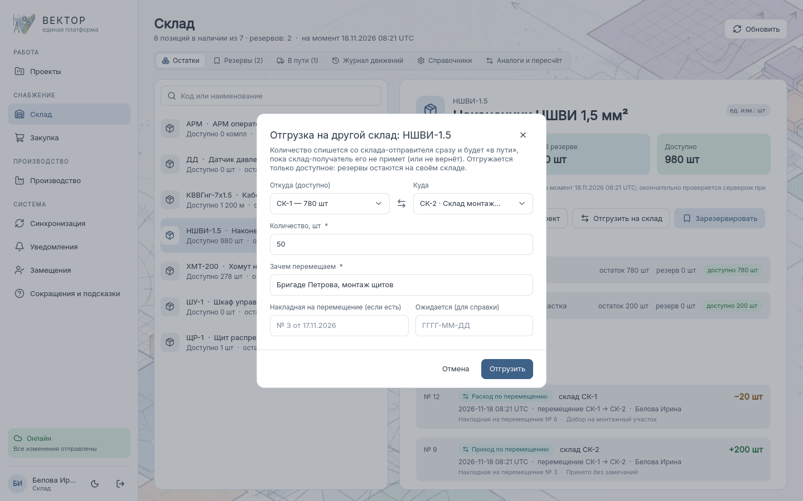

     * «Откуда» — только склады, где позиция **доступна**; резервы остаются на своём складе (чтобы отгрузить
       зарезервированное, сначала снимите резерв). «Куда» — любой другой действующий склад; с отключённого склада
       отгружать можно (так освобождают закрываемый склад).
     * Причина обязательна, накладная на перемещение — если оформляется.
     * Количество **сразу списывается** у отправителя («Расход по перемещению» в журнале) и становится **«в пути»**:
       его нет ни на одном складе, ни в «Доступно». На карточке позиции появляется плашка «В пути» и список
       перемещений с кнопками.
     * «Ожидается (для справки)» — ожидаемая дата прибытия в формате ГГГГ-ММ-ДД, по желанию. Если дата прошла, а
       перемещение ещё в пути, в списке появится пометка «срок прошёл». Больше ни на что срок не влияет.
  2. **Принять** — на вкладке «В пути» или на карточке позиции. Количество приходит на склад-получатель
     («Приход по перемещению») и становится доступным там. Комментарий — по желанию.
     * **Пришло меньше?** Введите в «Фактически пришло» пересчитанное количество (пусто — пришло всё). Программа
       покажет недостачу и попросит **причину** и **подпись приёмщика**: флажок «Подписываю акт…» и — если так
       настроено в компании (по умолчанию да) — **ваш пароль**. Пароль проверяет сервер; он нигде не сохраняется.
       Кнопка станет «Принять и подписать акт». Способ подписи выбирает администратор (флажок / пароль / КЭП); если
       выбрана КЭП, которая ещё не подключена, форма скажет, что подписать нельзя, — обратитесь к администратору.

       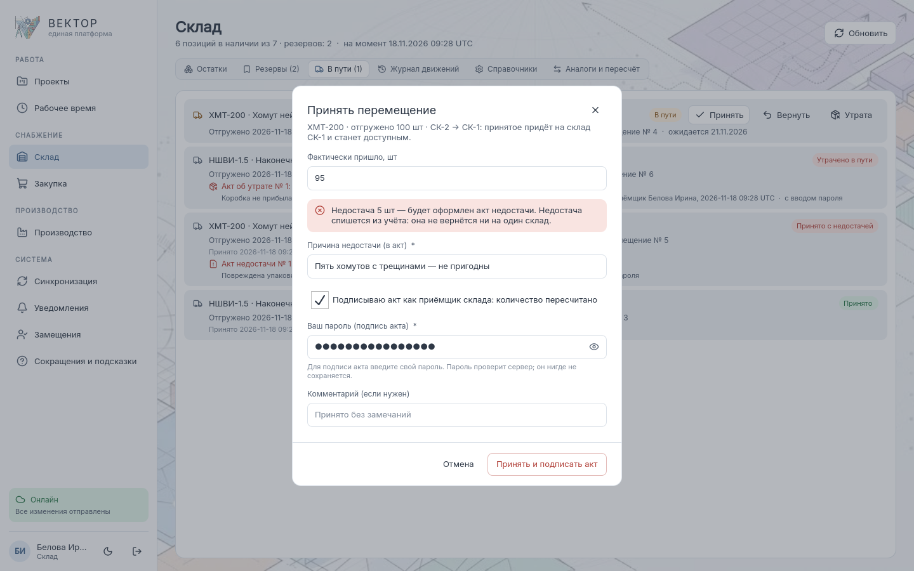

     * На склад приходует только фактическое количество. Разница оформляется **актом недостачи** со сквозным
       номером: отгружено / принято / недостача, причина, кто, когда и как подписал («с вводом пароля»,
       «подтверждение в программе»). Перемещение получает статус «Принято с недостачей». Акт изменить нельзя:
       программа хранит контрольную сумму подписанного и предупредит, если содержание вдруг не совпадёт.
     * Недостача **списывается из учёта**: она не возвращается ни на один склад. Кто за неё отвечает, программа не
       решает.
     * Больше отгруженного принять нельзя: излишек оформляют обычным приходом с основанием.
  3. Или **Вернуть** — если товар не принимают (пересорт, отгружено не туда): количество возвращается на
     склад-отправитель («Возврат по перемещению»). Причина обязательна.
  4. Или **Утрата** — если **не пришло ничего** (потеряно, похищено, не доехало). Приёмщик склада-получателя
     оформляет **акт об утрате**: пишет, что известно (претензия перевозчику, номер, обстоятельства — обязательно),
     ставит флажок «Подписываю акт…» и, если так настроено, вводит пароль.
     * Прихода нет и отправителю ничего не возвращается: количество, списанное при отгрузке, окончательно выбывает
       из учёта. Статус — «Утрачено в пути», в строке — «Акт об утрате № N» с причиной и подписью.
     * После этого принять, вернуть или оформить утрату ещё раз нельзя.
     * **Груз нашёлся?** Оформите обычный приход на склад, где он оказался, с основанием «найдено по акту об утрате
       № N». Акт об утрате при этом остаётся — история не переписывается.
     * Пришла часть — это не утрата, а недостача (п. 2).

       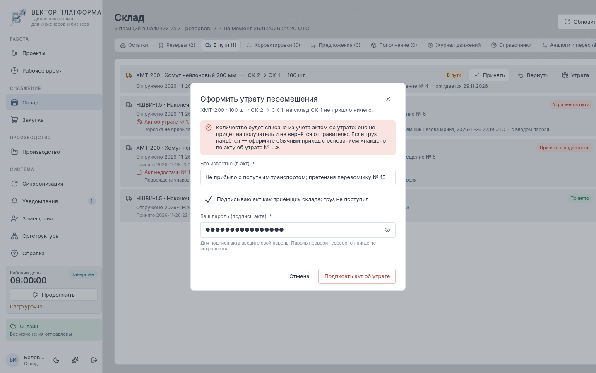

  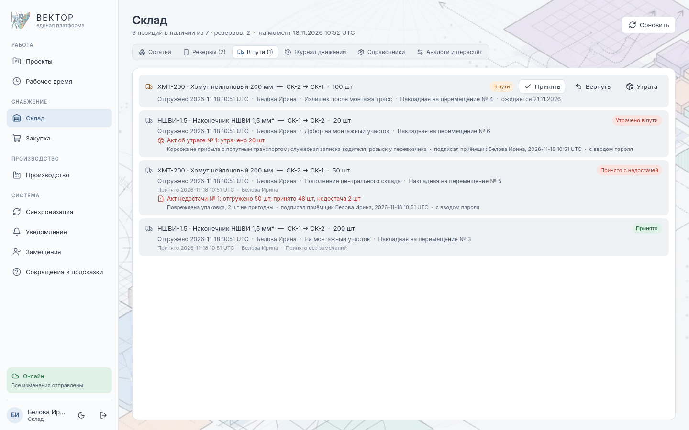

  * Если два кладовщика одновременно нажмут «Принять», «Вернуть» или «Утрата», сработает только первое; второй
    увидит, что перемещение уже закрыто, — двойного прихода не бывает.
  * Принять на **отключённый** склад нельзя — включите склад или верните перемещение. Вернуть на отключённый
    склад-отправитель можно.
  * Отгрузка, приёмка и возврат — **только при связи** с сервером. Без связи список «В пути» виден, кнопки неактивны.
  * У записей перемещения **нет кнопки «Сторно»**: отменить одну половину значило бы «потерять» товар. Пока
    перемещение в пути — его возвращают; после приёмки ошибку исправляют **обратным перемещением**.
  * Перемещения, проведённые до появления статуса «в пути» (одним шагом), показаны как «Принято» без кнопок.
* **Сторно** — исправление ошибочной проводки встречной записью «Сторно прихода/выдачи № N». Исходная запись
  остаётся в журнале с пометкой «Сторнировано»; повторно сторнировать нельзя. Сторно прихода невозможно, если
  товар уже зарезервирован, выдан или отгружен на другой склад.
* **Журнал движений** — все проводки с номерами, основаниями и авторами.

  

* **Справочники**: склады (код, название; отключённый склад не принимает приход и резерв) и номенклатура (код,
  наименование, единица; единицу нельзя менять, если по позиции уже были движения).
* **Аналоги и пересчёт** (склад и закупка, только при связи):

  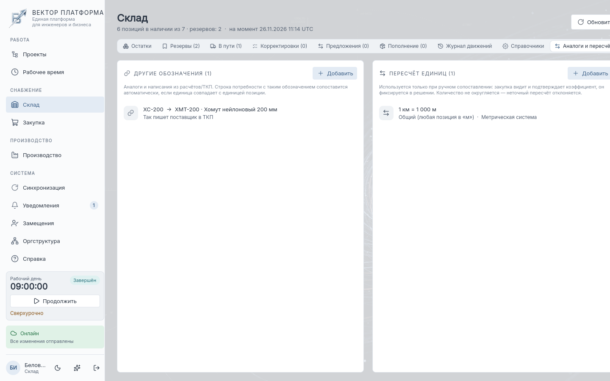

  * **Другие обозначения** — как позицию называют в расчётах и ТКП (например, «ХС-200» для «ХМТ-200»). Если в
    строке расчёта стоит такое обозначение **и единица совпадает** с единицей позиции, потребность сопоставит
    строку автоматически, с пометкой «по другому обозначению». Обозначение уникально и не может совпадать с кодом
    другой позиции. Позицию у обозначения не меняют — отключите его и заведите новое (история сохраняется).
  * **Пересчёт единиц** — «1 [из] = [коэффициент] [в]», например «1 км = 1000 м» (общий, для любой позиции в
    метрах) или «1 бухта = 100 м» (только для конкретного кабеля). Коэффициент больше нуля, не больше 4 знаков
    после запятой. Обратный пересчёт сам не создаётся. Пересчёт **не применяется автоматически** — только при
    ручном сопоставлении, когда закупка видит и подтверждает коэффициент. Изменение коэффициента не трогает уже
    принятые решения.

## 14. Закупка

* **Сформировать потребность** — закупка явным действием по **последней зафиксированной версии** расчёта
  комплекта (только при связи). Строки — без цен. Строка сопоставляется с номенклатурой автоматически, если
  обозначение совпало с кодом позиции или с её **другим обозначением** («Склад» → «Аналоги и пересчёт») **и**
  совпала единица; иначе — «Не сопоставлена» с причиной. По одной версии потребность формируется один раз.
* **Сопоставить вручную** (только закупка, только при связи). Если строка «Не сопоставлена» (нет обозначения, нет
  такой позиции, другая единица), нажмите **Сопоставить** у строки, выберите позицию номенклатуры и напишите, почему
  она подходит. В списке — действующие позиции **с той же единицей** и позиции, для которых в справочнике есть
  **пересчёт** из единицы строки. У такой позиции показано правило и результат, например «1 км = 1000 м: 1,85 км =
  1850 м»; кнопка называется «Сопоставить с пересчётом». Если результат получается больше чем с 4 знаками после
  запятой, выбрать позицию нельзя — программа не округляет количество за вас. Если позиции нет — заведите её
  («Склад» → «Справочники») или пересчёт («Склад» → «Аналоги и пересчёт»).
* **Коэффициент фиксируется в решении.** Резерв и покрытие строки дальше считаются в единицах позиции (под строкой
  написано «В единицах позиции: 1850 м»). Если коэффициент в справочнике успели изменить, пока вы смотрели форму,
  программа откажет («пересчёт изменили») — обновите данные и подтвердите новое число.

  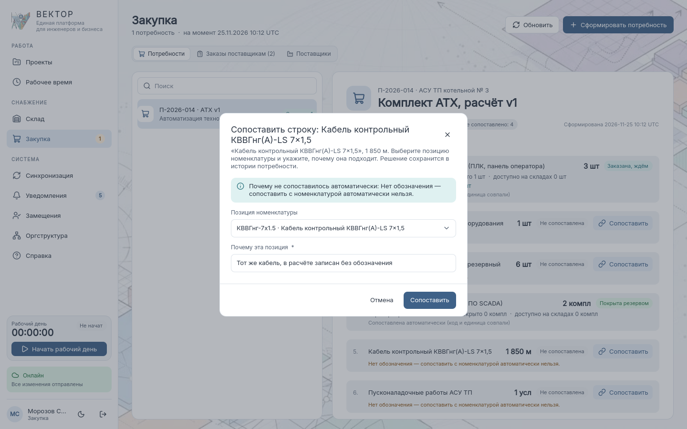

  После этого под строкой написано «Сопоставлена вручную: <причина>», и склад может резервировать под неё. Решение
  можно поменять (**Изменить**). Если под строку уже есть резервы, действует настройка компании «Пересопоставление
  при резервах» (её задаёт администратор, § 17): **«Запрещено»** (так и тогда, когда настройка не задана) — сначала
  склад снимает резервы; **«Снимать действующие резервы»** — резервы снимутся сами с вашей причиной, но только если у
  вас есть право снимать резервы (роль «Склад»); иначе попросите склад. Если по строке уже **выдано** со склада,
  сменить позицию нельзя при любой настройке. Все
  решения сохраняются в «Истории изменений» потребности — прежние не стираются. Если коллега одновременно
  изменил ту же потребность, программа сообщит о конфликте: обновите данные и повторите.
* **Покрытие**: для каждой строки — требуется, в резерве, осталось покрыть, доступно на складе.
* Склад резервирует под строку кнопкой **Зарезервировать** (не больше непокрытого).
* ГИП и РП видят потребность **своего** проекта; доступное количество для них — «неизвестно» (у них нет прав на
  складские данные), а не ноль.
* В строке потребности также написано **«Заказано, ждём: N»** — сколько по ней заказано в размещённых заказах
  поставщикам и ещё не пришло (черновики заказов не считаются).

Раздел «Закупка» состоит из вкладок **Потребности**, **Заказы поставщикам** и **Поставщики**. Закупка видит все
три; бухгалтерия и согласующий («Согласование закупок») — заказы и поставщиков; склад — заказы (без цен) и
поставщиков.

### 14.1. Заказы поставщикам

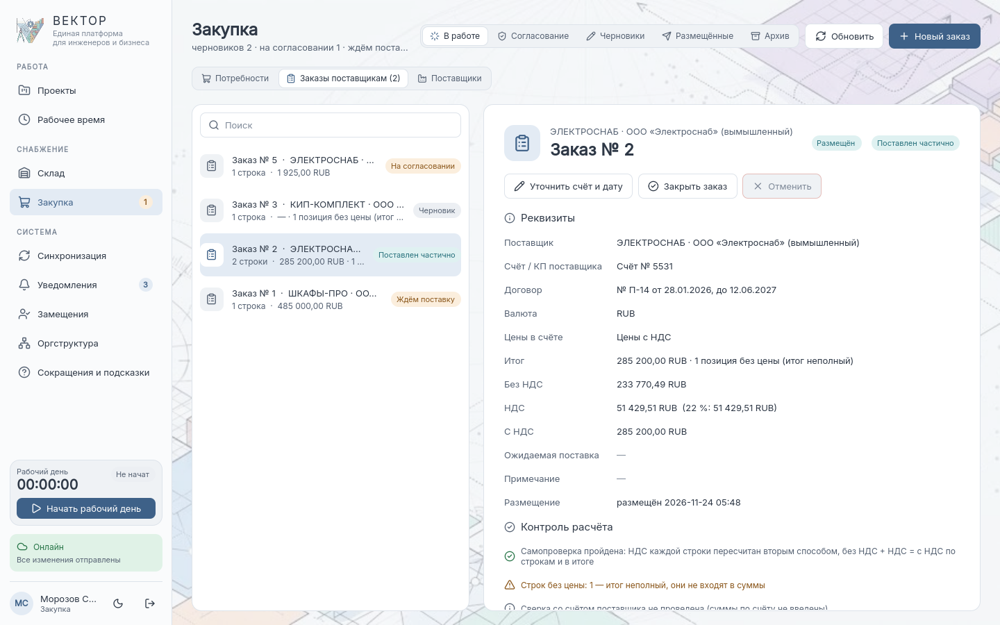

* **Путь заказа:** «Черновик» → «На согласовании» → «Согласован» → «Размещён» → «Закрыт»; отдельно — «Отменён» и
  «Возвращён на доработку». Номер (№ 1, № 2 …) назначает сервер при первом сохранении. У размещённого заказа рядом
  со статусом — состояние поставки: «Ждём поставку», «Поставлен частично», «Поставлен полностью». Его считает
  программа по приходам, вручную оно не ставится. Фильтр **«Согласование»** показывает заказы, ждущие решения.
* **Новый заказ / Изменить черновик** (закупка). Черновик можно сохранять **без связи**: он уйдёт на сервер вместе
  с очередью (до этого в списке — «Новый заказ (не отправлен)»). Строка — позиция номенклатуры, количество в её
  единице, цена за единицу, **ставка НДС** и, если нужно, **строка потребности**, под которую заказываете (только с
  той же позицией, что выбрана в потребности). Вверху — поставщик, **договор** (из действующих договоров этого
  поставщика или «без договора»), валюта и **«Цены в счёте»: с НДС или без НДС**.

  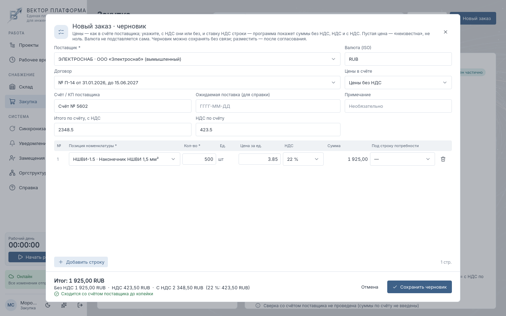

* **Цены** — так, как в счёте поставщика. Пустая цена значит «неизвестна» (не ноль): итог показывается как
  «… · 1 позиция без цены (итог неполный)». Если указана хоть одна цена, нужна валюта (три буквы, например RUB).
  Сама она не подставляется. Больше 4 знаков после запятой ввести нельзя: программа не округляет за вас.
* **НДС раздельно.** Выберите, как даны цены в счёте — **с НДС** или **без НДС**, — и ставку у каждой строки: 22, 10,
  7, 5, 0 % или «Без НДС» (в новую строку подставляется ставка поставщика из его реквизитов). Внизу редактора и в
  карточке заказа — три суммы: **без НДС**, **НДС** (и по ставкам) и **с НДС**. НДС считается по каждой строке и
  округляется до копеек; итоги — суммы строк. Если режим или ставка не указаны, вместо сумм НДС — «—» и причина
  (а не ноль). Для черновика это не обязательно, но отправить такой заказ на согласование нельзя — внизу
  подсказка «Для согласования: …». Цены, суммы и НДС видят закупка, бухгалтерия, согласующий и руководитель
  отдела; склад видит количества и ставки, без денег.
* **Контроль расчёта и сверка со счётом** (D-34). В редакторе можно ввести **«Итого по счёту, с НДС»** и **«НДС по
  счёту»** — как в счёте поставщика, в рублях и копейках (необязательно). Внизу редактора и в карточке — блок
  **«Контроль расчёта»**: программа пересчитывает НДС каждой строки **вторым, независимым способом** и проверяет
  «без НДС + НДС = с НДС» по строкам и в итоге; если что-то не сошлось — суммы НДС не показываются вовсе и заказ не
  отправить (лучше «не посчитано», чем неверная цифра; сообщите администратору). Там же — **совпадает ли расчёт со
  счётом** до копейки и предупреждение о строках, сумма которых с долями копейки (например, 333 × 3,8555): в счёте
  поставщика она будет округлена. Суммы по счёту входят в согласуемое содержание.

  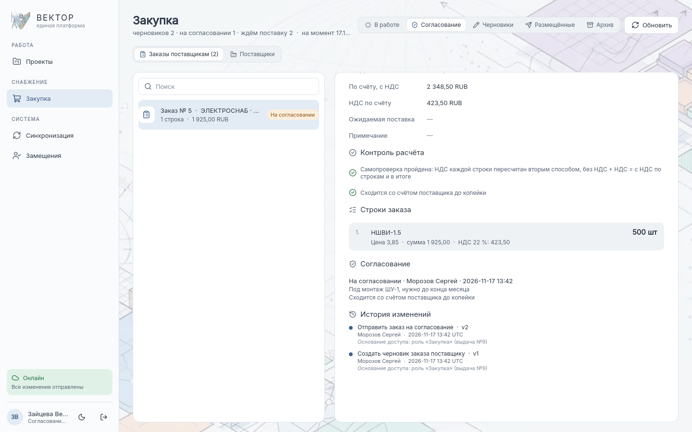
* **На согласование** (закупка, только при связи). Согласование **обязательно**: разместить можно только
  согласованный заказ. Сервер сразу проверит черновик полностью (строки, валюта, режим цен и ставки, поставщик,
  договор, позиции, привязки к потребности) и отправит согласующему **ровно это содержание**. Пока заказ на
  согласовании или согласован, его условия **не меняются** — только номер счёта, ожидаемая дата и примечание.
  Изменить условия — **«Отозвать с согласования»**, поправить и отправить снова. Если расчёт **не совпал со счётом**
  (или сверить нельзя — например, у строк нет цены), форма попросит **причину расхождения** («поставщик считает НДС
  от итога счёта» и т. п.): без неё заказ не отправить, а согласующий увидит её в истории согласования.
* **Согласовать / Вернуть на доработку** (роль «Согласование закупок» — своя или по замещению, — а также
  руководитель отдела как резервный согласующий; только при связи). Согласующий видит заказ
  целиком — с ценами, НДС и договором — и либо согласует (комментарий по желанию), либо возвращает с
  **обязательной причиной**; закупка видит её в карточке («Возвращён на доработку: …»). **Свой заказ согласовать
  нельзя**: если вы его создали или отправили, решает другой сотрудник. Вся история — в разделе «Согласование»
  карточки (кто, когда, комментарий; решение по замещению — «Никитина Ольга (замещает Зайцеву Веру)»; сверка со
  счётом и причина расхождения при отправке).

  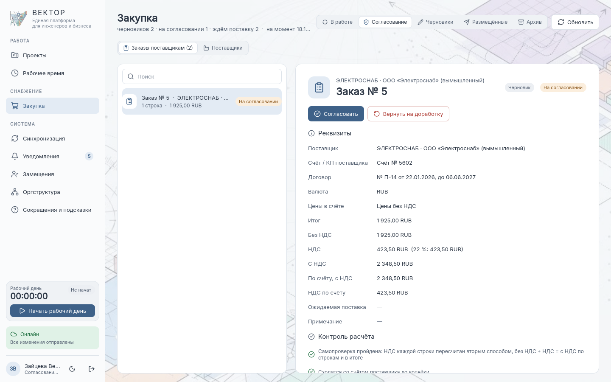

* **Разместить** (закупка, только при связи) — только **согласованный** заказ. Сервер ещё раз проверит
  поставщика, договор (действует и не истёк), позиции и привязки к потребности, а также что содержание совпадает с
  согласованным. После размещения **поставщик, договор, валюта, НДС и строки больше не меняются**. Кнопкой
  **«Уточнить счёт и дату»** можно изменить только номер счёта поставщика, ожидаемую дату и примечание. Нужны
  другие условия — закройте или отмените заказ и разместите новый. Если содержание заказа изменено в обход
  программы, в карточке появится предупреждение, и разместить такой заказ нельзя.
* **Закрыть заказ** (только при связи) — когда поставка завершена. Если поставлено не всё, нужна причина.
  После закрытия поставки по заказу не принимаются.
* **Отменить** — только пока по заказу ничего не поставлено (ошибочный приход сначала сторнирует склад); причина
  обязательна.

### 14.2. Приём поставки (склад)

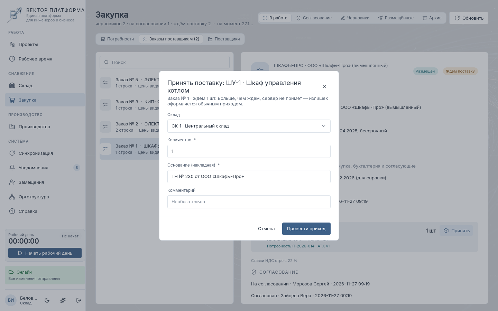

У строки размещённого заказа нажмите **Принять** и укажите склад, количество и основание (накладную). Работает
только при связи. Это обычный приход журнала склада с пометкой «по заказу № N». Принять **больше, чем ещё ждём**,
нельзя: излишек оформляется обычным приходом («Склад» → «Приход»). Ошибочный приход по заказу сторнируют как любое
движение: тогда «поставлено» уменьшается.

### 14.3. Поставщики

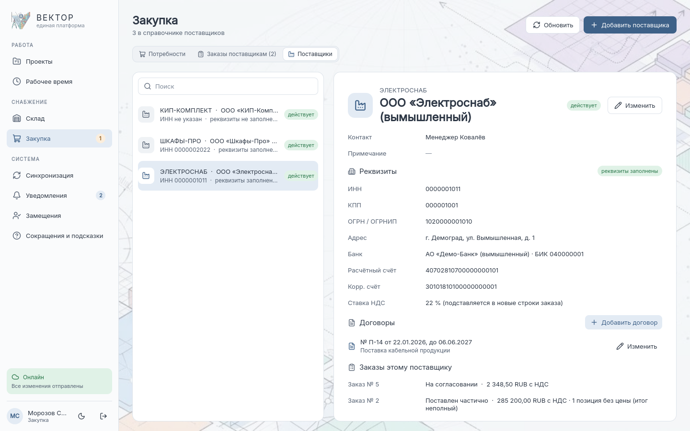

Справочник ведёт закупка: **код** (короткий, уникальный, потом не меняется), название, контакт, примечание и
**реквизиты**: ИНН, КПП, ОГРН/ОГРНИП, юридический адрес, банк, БИК, расчётный и корреспондентский счёт, ставка НДС
по умолчанию. Реквизиты необязательны, но если указаны — программа сразу проверит их (контрольные цифры ИНН и
ОГРН; расчётный и корр. счёт — по БИК, поэтому счёт без БИК не принимается; у ИП нет КПП). В списке и карточке —
«реквизиты заполнены / не заполнены»: это подсказка, а не запрет. Поставщика не удаляют, а **отключают**: новых
заказов ему не согласовать и не разместить, уже размещённые остаются. Новую карточку можно завести и без связи.

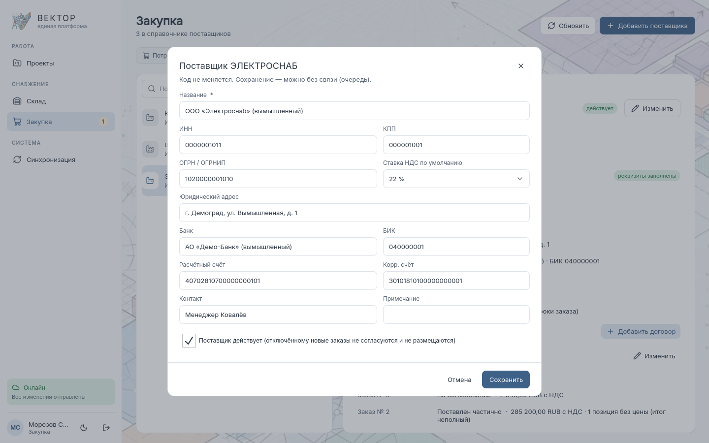

**Договоры** — в карточке поставщика, кнопка **«Добавить договор»** (закупка, можно без связи): номер (уникален у
поставщика, потом не меняется), дата заключения, «действует до» (пусто — бессрочный), предмет, примечание. Договор
не удаляют, а отключают. В заказе можно выбрать только **действующий и не истёкший** договор этого поставщика;
истёкший помечен «истёк». Заказ без договора тоже допустим.

### 14.4. Замещения

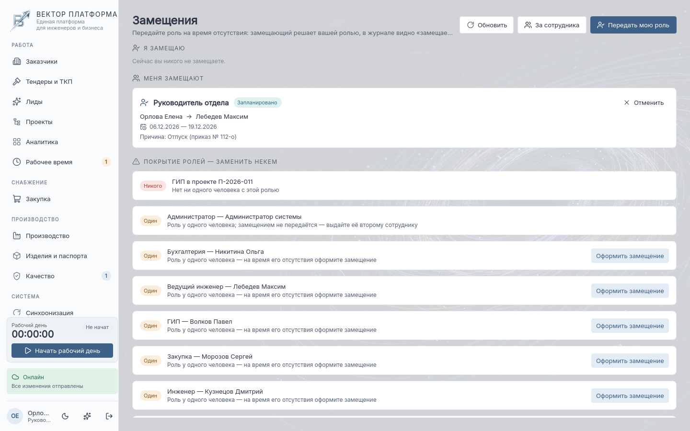

Раздел **«Замещения»** (меню «Система») есть у всех: никто не должен быть незаменимым (D-34).

* **«Передать мою роль»** — на время отпуска или командировки: роль (из ваших собственных, кроме «Администратор»),
  замещающий, «с» (пусто — сегодня) и «по» (включительно, не дольше года), причина. Замещающий получает вашу роль на
  эти дни и решает от её имени; в истории его решения подписаны «замещает …». Вы роль **не теряете**. Замещение
  заканчивается само в последний день; отменить раньше — «Отменить» с причиной (вы, замещающий или тот, кто
  оформил). Только при связи.
* **«За сотрудника»** (руководитель отдела, администратор) — когда сотрудник отсутствует и не может оформить сам:
  выберите, чью роль и кому передать. Назначить замещающим себя нельзя — это сделает другой руководитель или
  администратор.
* **«Покрытие ролей»** (руководитель отдела, администратор) — роли, которые сейчас **ни у кого** или **у одного
  человека**: на время его отсутствия заменить некем. Кнопка «Оформить замещение» в строке открывает форму, уже
  заполненную этой ролью; число таких ролей — на значке в меню. «Администратор» замещением не передаётся — выдайте
  роль второму сотруднику.
* Полученную замещением роль **дальше не передают** (без цепочек). Если у самого сотрудника роль отозвали,
  замещение приостанавливается («Приостановлено: у носителя нет этой роли»). В строке профиля внизу меню
  полученная роль видна с пометкой «(замещение до …)».
* Руководитель отдела всегда **в курсе согласований**: видит заказы поставщикам с ценами и ходом согласования и
  может сам согласовать или вернуть заказ, если согласующего нет; о каждом заказе на согласовании ему приходит
  уведомление (§ 14.5).
* **Роль в проекте** (D-35) — ГИП, РП или участник конкретного проекта — передаётся так же: в списке «Роль» пункты
  вида «ГИП в проекте П-2026-014» (ваши назначения; у руководителя в «За сотрудника» — все проекты). Замещающий
  действует **только в этом проекте** и только пока у вас есть назначение (сняли с проекта — замещение
  «приостановлено»); роли вне проекта замещение в проекте не даёт. В «Покрытии ролей» — и ГИП/РП каждого
  проекта, если их нет или замещать некому. Замещающий видит роль в строке профиля: «ГИП в проекте П-2026-014
  (замещение до …)».
* Об оформлении и отмене замещения узнают замещающий, тот, чью роль передают, и руководители отдела —
  уведомлением (§ 14.5).

### 14.5. Уведомления

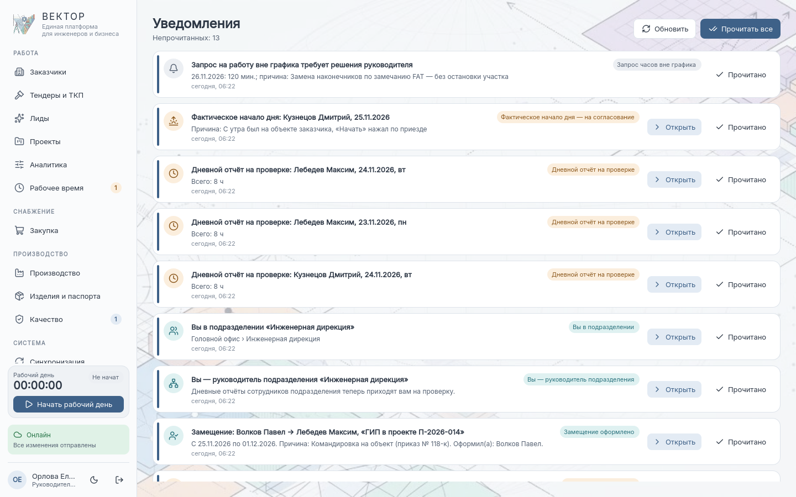

Раздел **«Уведомления»** (меню «Система») есть у всех; число непрочитанных — на значке в меню (D-35).

* **Что приходит.** Заказ отправлен на согласование или отозван — согласующим закупок и руководителям отдела (и
  тем, кто их замещает); заказ согласован или возвращён — закупщику, который его создал и отправил, и
  руководителям отдела; оформлено или отменено замещение — замещающему, тому, чью роль передали, и руководителям.
  О своих действиях уведомлений нет. **Сумм в уведомлениях нет** — они видны в карточке заказа тем, кому положено.
* **«Открыть»** — перейти к заказу (раздел «Закупка», карточка заказа) или к замещениям; уведомление отмечается
  прочитанным. **«Прочитано»** у строки и **«Прочитать все»** — только при связи; без связи список виден на момент
  последнего обновления.
* Новые уведомления приходят при обновлении данных (автоматически или F5); о пришедших во время работы программа
  скажет подсказкой «Уведомление: …». Кто был не в сети — увидит их при следующем входе.
* Хранятся 90 дней (показываются последние 200). Почта и мессенджеры пока не используются (вопрос A-41).

## 15. Производство

Раздел **«Производство»** (меню «Производство», `Ctrl+7`) видят технологи, производство, склад, руководители
отделов и РП/ГИП проектов, где есть техпроцессы или наряды (D-36). Порядок: **техпроцесс (ТП) → наряд →
исполнение операций → выдача материалов → закрытие**. Вкладки: «Мои операции» (исполнителю), «Наряды»,
«Техпроцессы».

### 15.1. Мои операции (исполнитель)

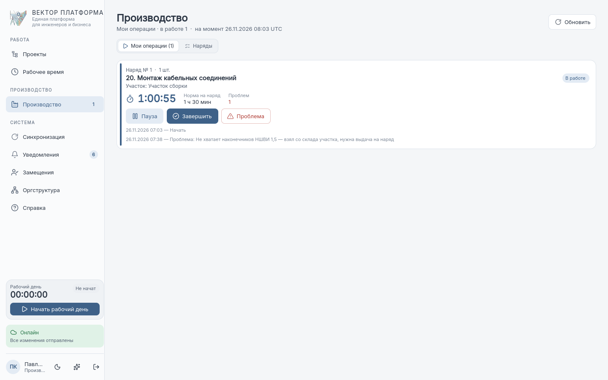

У роли «Производство» раздел открывается сразу; на значке в меню — число операций, которые ещё нужно сделать.

* Видны **только ваши** операции в открытых нарядах: наряд, операция, участок, норма на наряд, число проблем,
  последние события. Выполненные уходят из списка (история — в карточке наряда).
* Кнопки: **Начать** → **Пауза** / **Продолжить** → **Завершить**; **Проблема** — описать, что мешает (описание
  обязательно, его получает РП проекта). В «Завершить» можно указать, сколько изделий выполнено (пусто — весь наряд;
  больше, чем в наряде, нельзя).
* **Работает без связи.** Время отметки — **часы этого компьютера** в момент нажатия (A-44): таймер идёт сразу, отметки
  ждут в очереди с меткой «Не отправлено» и уходят на сервер, когда появится связь. Заведомо невозможное
  («Пауза» до «Начать») программа не даст сделать сразу. Если за это время наряд закрыли, операцию переназначили или
  часы компьютера ушли вперёд больше чем на 15 минут — сервер не примет отметку, и в разделе «Синхронизация»
  появится конфликт с объяснением (ничего не сливается молча).

### 15.2. Наряды (мастер — РП проекта)

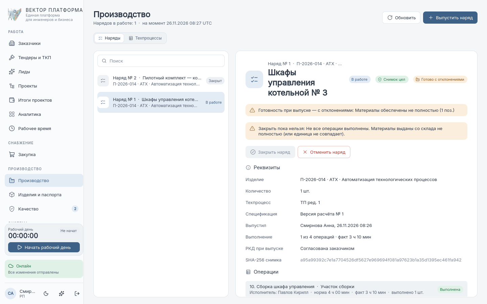

* **Выпустить наряд** (только при связи) — РП проекта, его замещающий или руководитель отдела (A-42): утверждённый
  ТП, количество изделий (целое), название, исполнители операций (можно назначить позже). При выпуске создаётся
  **снимок** — состав изделия × количество и операции с нормой на наряд; он не меняется. Метка **«Снимок цел»**
  означает, что снимок совпадает с выпущенным (SHA-256); «Снимок изменён» — правка в обход программы, сообщите
  администратору.
* **Назначить** исполнителя операции — только людям с ролью «Производство», пока операция не выполнена.
* **Заменить** позицию состава (ГИП проекта или технолог, при связи): новая позиция, количество и **причина**;
  программа показывает «было → станет», снимок не переписывается — замена хранится отдельно, действующий состав =
  снимок + замены.
* **Материалы** — сколько нужно по действующему составу, сколько выдано со склада на наряд и состояние. Склад
  выдаёт на наряд в форме «Выдать» (§ 13): у выдачи на проект есть поле **«Наряд»**.
* **Закрыть наряд** — когда все операции выполнены и всё складское по составу выдано в той же единице (работы и
  услуги не мешают, A-43). Пока нельзя — над кнопкой написано почему. **Отменить** — с причиной, пока не закрыт.
* Наряд сам становится «В работе» после первой отметки исполнителя и «Выполнен», когда выполнены все операции
  (РП получает уведомление «можно закрывать»).

### 15.3. Техпроцессы (технолог)

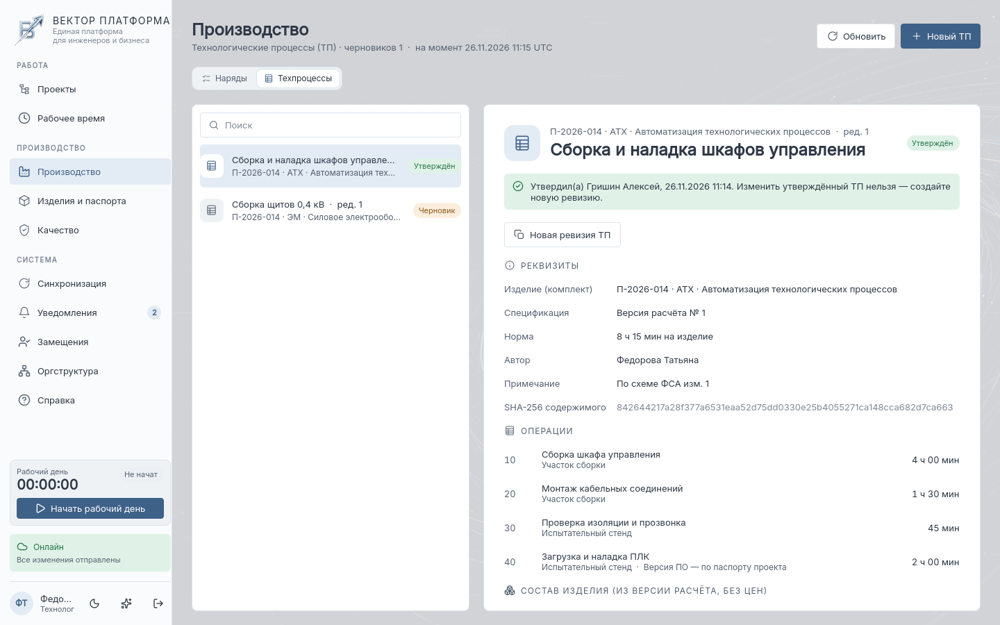

* **Новый ТП** — комплект проекта, спецификация (зафиксированная версия расчёта комплекта, **без цен**), название
  и операции: №, наименование, участок/оборудование, **норма в минутах на одно изделие** (можно «1,5»), примечание.
  Ошибки видны сразу у строки (повтор номера, норма не числом); внизу — норма на изделие.
* Черновик сохраняется **без связи** (очередь). У комплекта — один черновик.
* **Утвердить** — другой технолог или руководитель отдела, **не автор** (четыре глаза). Утверждённый ТП не
  меняется: для изменений — **Новая ревизия** (копия операций в новый черновик).

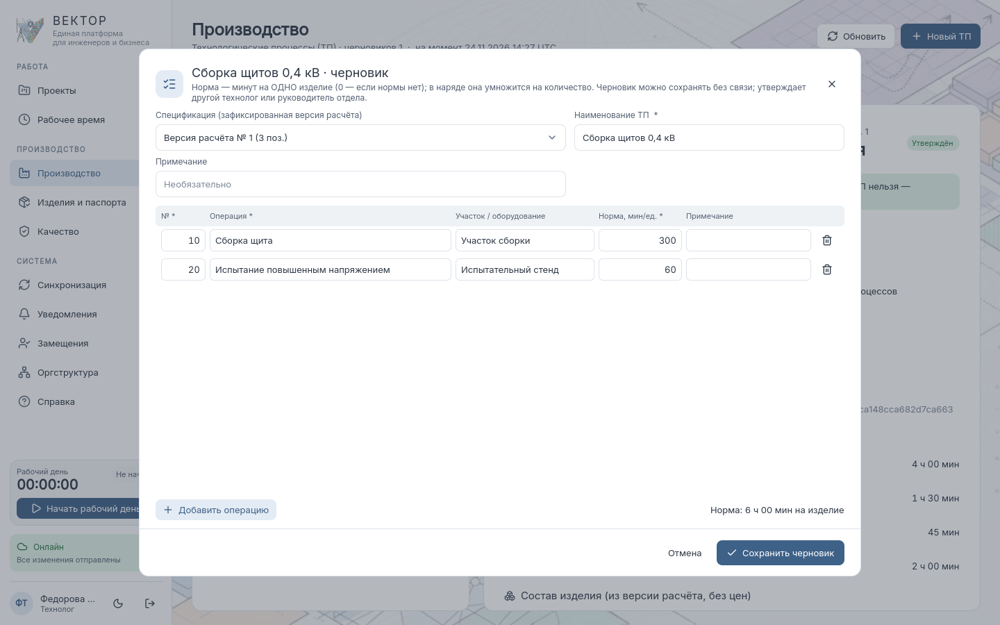

### 15.4. Изделия и паспорта (экземпляры, паспорт, эксплуатация)

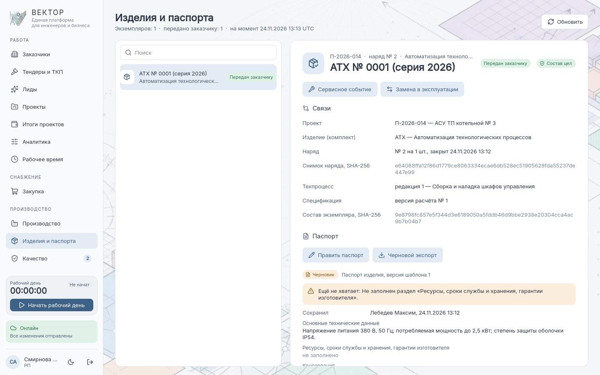

Раздел **«Изделия и паспорта»** (меню «Производство», `Ctrl+8`) видят команда проекта, технологи и руководители
отделов (D-38). Порядок: **закрытый наряд → экземпляры с заводскими номерами → паспорт (черновик) → передача
заказчику → сервис и замены**.

* **Зарегистрировать экземпляры** (только при связи) — РП проекта, его замещающий или руководитель отдела: закрытый
  наряд, **серия** и **заводские номера** по одному на строке — не больше, чем изготовлено по наряду. Номер не может
  повториться у того же изделия в той же серии (у другой серии — может). Если хоть один номер занят, не
  регистрируется ни один — программа перечислит занятые.
* **Карточка экземпляра.** «Связи» — проект, изделие, наряд и контрольная сумма его снимка, редакция ТП, версия
  расчёта и контрольная сумма состава экземпляра. Метка **«Состав цел»** — состав совпадает с зафиксированным при
  регистрации; «Состав повреждён» — правка в обход программы, сообщите администратору. Ниже — состав одного изделия,
  операции наряда (кто выполнял и сколько времени) и история эксплуатации.
* **Паспорт** — черновик по шаблону-мастеру. **Создать паспорт** / **Править паспорт** — РП или ведущий инженер,
  участник проекта; **можно без связи** (очередь). Основные сведения, комплектность и движение изделия программа
  подставляет сама; вы пишете тексты разделов (технические данные, гарантии, консервация, упаковка, свидетельство о
  приёмке), испытания (результат, дата, протокол) и выбираете документы проекта — закрепляется **точная версия**.
  Гарантийные условия, подписи и печати программа **не** подставляет. Над паспортом написано, чего ещё не хватает.
* **Черновой экспорт** (только РП и только при связи) — файл HTML с пометкой **«Черновик, не сертификат»** на каждой
  странице; каждый экспорт записывается в журнал (номер, кто, когда, контрольная сумма).
* **Передать заказчику**, **Сервисное событие** (ввод в эксплуатацию, осмотр, обслуживание, ремонт, отказ), **Замена в
  эксплуатации** (что снято и что установлено, номера, причина) — только при связи, РП или руководитель отдела.
  Записи истории не меняются и не удаляются; дата — не позже сегодняшней. Состав при изготовлении замена не меняет.

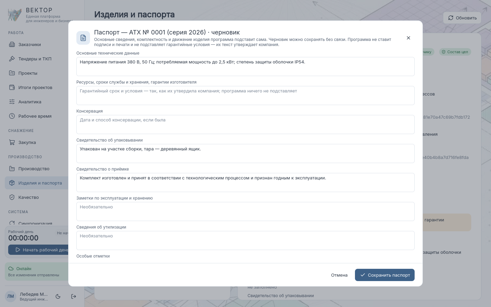

### 15.5. Качество: рекламации, CAPA, запросы и извещения об изменении

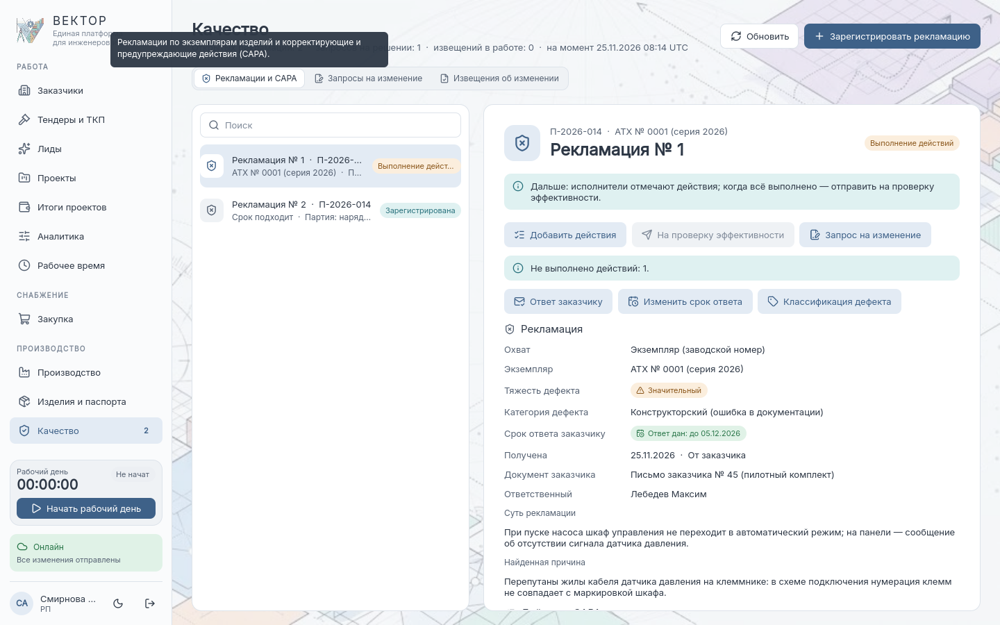

Раздел **«Качество»** (меню «Производство», `Ctrl+9`) видят команда проекта, технологи, руководители отделов и
**ОТК — отдел технического контроля** (D-39–D-41; сотрудник ОТК работает **по проектам** — видит и ведёт рекламации
только тех проектов, куда его назначил участником ГИП или РП, и начинает работу с этого раздела).
Бейдж у пункта меню — сколько ждёт **вашего** решения или отметки. Три вкладки:

**Рекламации и CAPA** (CAPA — корректирующие и предупреждающие действия). Порядок: **рекламация → анализ причины →
план действий → выполнение → проверка эффективности → закрыта**.

* **Зарегистрировать рекламацию** — РП или ГИП проекта, ОТК этого проекта (резерв — руководитель отдела), **можно без связи**.
  **К чему относится:** экземпляр изделия (заводской номер); **партия (наряд)** — если номер неизвестен, выберите
  выполненный наряд, по которому изделия выпущены; **проект** — если нет ни номера, ни партии. Дальше: от заказчика или
  внутренняя, дата получения, **тяжесть дефекта** (критический — опасен или изделие не работает; значительный —
  работает с ограничениями; незначительный — на работу не влияет), **категория** (откуда дефект — если уже ясна),
  документ заказчика, суть. Для рекламации **от заказчика** обязателен **срок ответа заказчику** — из договора или
  письма; кнопки «+5 дн.», «+10 дн.», «+30 дн.» лишь считают дату от дня получения.
* **Начать анализ** — назначить ответственного (участник проекта, в том числе сотрудник ОТК, назначенный в проект —
  в списке он помечен «(ОТК)»; ответственный получит уведомление).
* **Причина и план CAPA** — записать найденную причину и действия: вид (корректирующее устраняет причину,
  предупреждающее не даёт ей повториться), что сделать, исполнитель, срок. Нужно хотя бы одно корректирующее;
  ошибки подсвечиваются в строках до отправки. Если категория дефекта ещё не указана — укажите её здесь
  (по найденной причине). Позже можно **добавить действия**.
* **Выполнено** — исполнитель действия (или тот, кто ведёт рекламацию) отмечает его и пишет результат.
* **На проверку эффективности** — когда все действия выполнены.
* **Проверить эффективность** — РП, ГИП или руководитель отдела, но **не тот**, кто составлял план, выполнял действия
  или отправлял на проверку; если это вы — кнопка недоступна и рядом написано почему. «Эффективно» закрывает
  рекламацию, «Не эффективно» возвращает к действиям. Каждая проверка записывается навсегда. ОТК проекта
  проверяет наравне с РП и ГИП — по тому же правилу «не участвовавший».

**Срок ответа заказчику** (D-40). В списке и карточке рекламации видно: «в срок», «срок подходит» (за 2 дня и в день
срока — жёлтым), «срок прошёл» (красным) или «ответ дан». РП, ГИП, ответственный за анализ и ОТК проекта получают
уведомление «Срок ответа заказчику подходит» / «прошёл» (один раз на срок).

* **Ответ заказчику** — записать отправленный ответ: промежуточный или окончательный, дата отправки, что ответили,
  номер письма. Запись не меняется и не удаляется (раздел «Ответы заказчику» в карточке). Ответ после установки срока
  закрывает срок.
* **Изменить срок ответа** — новый срок по согласованию с заказчиком или для следующего (окончательного) ответа;
  причина обязательна. После этого отсчёт «ответ дан» начинается заново.
* **Классификация дефекта** — уточнить тяжесть и категорию; причина попадёт в историю. Критический дефект — отдельное
  уведомление «Критический дефект» тем, кто ведёт рекламацию.

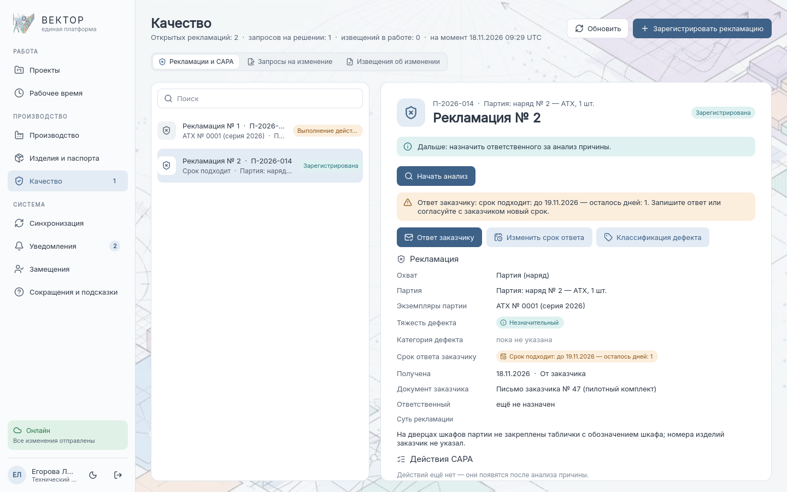

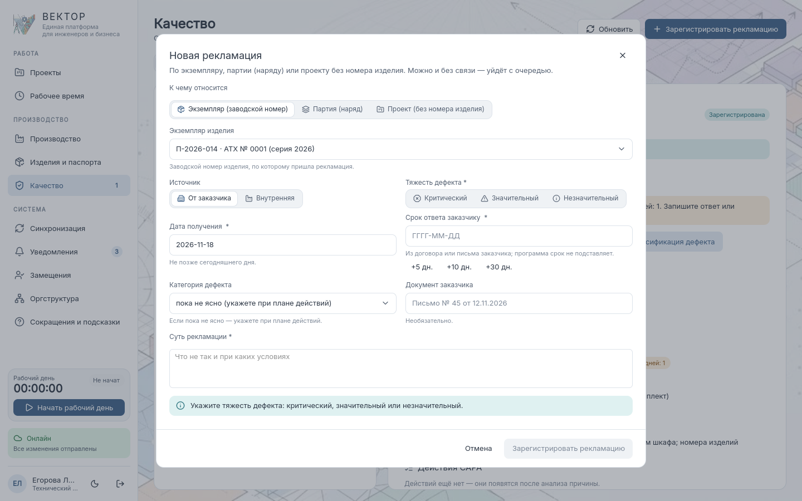

**Запросы на изменение** (ECR) — если причина в документации или техпроцессе. **Подать запрос** может любой участник
проекта и ОТК (можно без связи, в том числе из карточки рекламации — «Запрос на изменение»). **Оценить влияние** — РП или
ГИП; **Решение** (принять или отклонить с обоснованием) — ГИП проекта, но не автор запроса.

**Извещения об изменении** (ECO) — по принятому запросу. **Составить извещение** / **Править извещение** — РП или ГИП,
можно без связи: описание и строки с **точными версиями** — документ проекта с номером его последней версии или
редакция техпроцесса. **Утвердить** — ГИП, который извещение не составлял и не правил. **Отметить внедрение** — для
каждой строки: новая версия документа (сначала загрузите её в «Документах») или утверждённая новая редакция
техпроцесса (её выпускает технолог). **Проверить внедрение** — не тот, кто отмечал внедрение. В карточке видно,
**каких экземпляров касается** изменение.

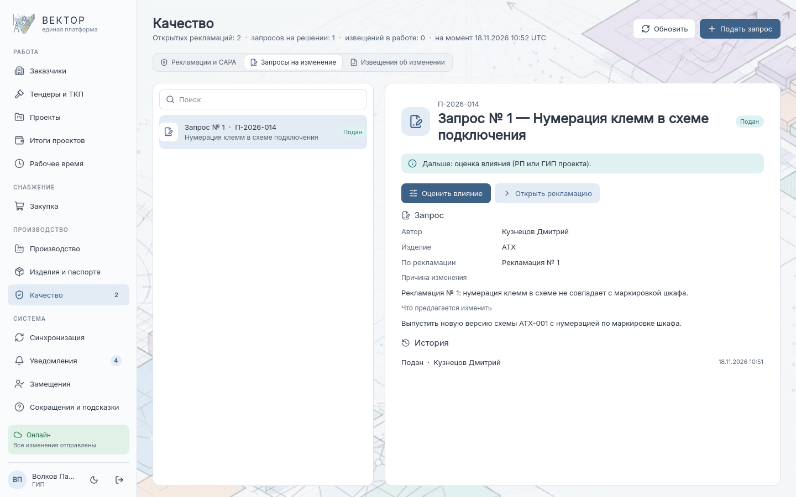

## 16. Рабочее время

Раздел **«Рабочее время»** (меню «Работа», `Ctrl+0`) есть **у всех**: каждый ведёт свой **дневной отчёт** — смену и
то, на что ушло время, — и отмечает рабочий день **таймером** (см. «Таймер рабочего дня» ниже). Проверяет отчёты **руководитель отдела** (и его замещающий).

**Дневной отчёт** — один за рабочий день:

* **смена** — начало и конец в виде `ЧЧ:ММ` (например, 08:30 и 17:30) и перерыв в минутах. **Ночная смена:** если
  конец раньше начала (22:00 и 06:00), смена закончилась утром следующего дня — в итогах видно «Ночная смена». Смена
  не длиннее суток и не должна пересекаться со сменой соседнего дня — иначе программа не даст отправить отчёт;
* **строки «на что ушло время»** — проект (только тот, где вы участник; «Не по проекту» — общие дела отдела), задача
  проекта (необязательно), **часы** и **что сделано**. Часы вводите как удобно: `2`, `1,5` или `1:30`;
* внизу формы видно: сколько в строках, сколько длится смена без перерыва и сколько **не распределено**.

Как заполнить:

1. **«Заполнить за сегодня»** (или **«За другой день»**, если забыли вчера: новый отчёт — не старше 31 дня).
2. Укажите смену и добавьте строки → **«Сохранить»**. Сохранять можно сколько угодно раз и **без связи** — черновик
   уйдёт на сервер при подключении.
3. **«Самопроверка и отправка»** — тоже можно без связи. Отметьте три пункта самопроверки: смена и перерыв верны;
   учтены все работы, лишнего нет; часы в строках проверены. Пока отмечены не все, «Отправить» недоступна. Программа
   также не даст отправить, пока не указана смена, нет ни одной строки или в строках **больше часов, чем смена без
   перерыва** (меньше — можно).

**Если отчёт не написан — его соберёт программа.** На следующий день, при синхронизации (кнопка «Обновить» или
автоматически), программа смотрит, что вы делали в ней за прошедшие дни (до 7 дней), и за каждый день с действиями,
но без отчёта собирает отчёт сама:

* **смена** — из **таймера рабочего дня** (см. ниже), если вы его запускали: начало, конец и перерывы — как нажимали,
  без округления. Без таймера — от первого до последнего действия, тоже без округления, а перерыва нет (программа
  перерывы не угадывает — перерыв считается только по кнопке «Перерыв»);
* строки с меткой **«по таймеру»** — время операций нарядов по таймеру («Начать» … «Завершить»), фактическое;
* строки с меткой **«оценка программы»** — остальное время смены, разделённое между работами (проект и задача) по
  числу ваших действий. **Это оценка — проверьте её**: совещания и работу на бумаге программа не видит.

Такой отчёт — в статусе **«На самопроверке»**, вам приходит уведомление «Отчёт собран — проверьте». Руководитель его
**не видит**, пока вы не пройдёте самопроверку и не отправите. Исправленная вами строка теряет метку — она становится
«вашей». Отчёт за день, где вы ничего не делали в программе, не собирается.

Что дальше:

* **«Принят»** — всё; **«Возвращён»** — вверху карточки причина: исправьте («Изменить») и отправьте снова;
* нашли ошибку в уже отправленном или принятом отчёте — **«Исправить»** (только при связи): укажите основание, отчёт
  снова станет черновиком; основание сохранится в истории, а если отчёт уже приняли — руководитель получит уведомление.

**Руководителю отдела** — вкладка **«На проверке»** (открывается сама, если есть что проверить; бейдж в меню —
сколько ждёт). Откройте отчёт: смена, строки по проектам и задачам, итоги → **«Принять»** или **«Вернуть»** с
причиной — что исправить (только при связи). **Свой отчёт** руководитель не проверяет — это делает другой
руководитель (выше по оргструктуре) или замещающий («четыре глаза»). В истории отчёта видно, кто и когда принял (и «замещает: …»).
Черновики сотрудников не видны никому, кроме автора.

**Кому уходит отчёт** (D-44, D-45). Если вы включены в **оргструктуру** (см. ниже), отчёт уходит **руководителю
вашего подразделения** — отдельная роль ему для этого не нужна; нет руководителя (или его учётная запись отключена,
или это вы сами) — руководителю ближайшего **вышестоящего** подразделения. Уведомление получает и тот, кто замещает
руководителя по роли «Руководитель отдела». Видят и могут проверить отчёт
руководители **по цепочке вверх** (для статистики); руководитель соседнего отдела — нет. Сотрудник вне оргструктуры —
по-прежнему: отчёт видят все руководители отделов, так что отчёт никогда не «повисает».

**Недельные итоги подразделений (D-50).** На вкладке «На проверке» руководитель видит агрегат за прошлую полную неделю: число отправленных отчётов и суммарное время по своему подразделению и вложенным подразделениям. Персональных строк в сводке нет. Это деловая метрика, а не юридический табель; активность клавиатуры, мыши и названия программ в сводку не входят.

### Таймер рабочего дня

Внизу боковой панели — карточка **«Рабочий день»** с таймером `ЧЧ:ММ:СС`; та же карточка, подробнее, — вверху раздела
«Рабочее время» (D-46).

* **«Начать рабочий день»** — таймер пошёл. **«Перерыв»** — таймер встал; **«Продолжить»** — пошёл дальше.
  **«Завершить день»** (с подтверждением) — день закончен; вернулись к работе — «Продолжить».
* Считается **сколько натикало** — по секундам, **без округления**. **Перерыв — только по кнопке** «Перерыв»:
  программа сама перерывы не угадывает.
* Время — **по часам этого компьютера**. Кнопки работают **без связи**: нажатия помечаются «не отправлено» и уходят
  на сервер при подключении (раздел «Синхронизация»). Сервер не примет только время «из будущего» (часы компьютера
  спешат больше чем на 15 минут) и невозможный порядок (например, «Перерыв» дважды).
* **Ночная смена:** день, начатый вечером и не завершённый, продолжается после полуночи.
* **График работы** (D-47) — под таймером: например, «Пятидневка: 08:00–17:00, пн–пт, перерыв 60 мин — подразделения
  «Отдел АСУ ТП»». Графики заводит и назначает администратор (см. «Оргструктура» → «Графики работы»).
* **Праздники и сокращённые дни** (D-48) — по производственному календарю, если ваш график его учитывает: в
  праздник окна «Начните рабочий день» нет (поработать можно — нажмите «Начать рабочий день» сами), в рабочую
  субботу по переносу окно есть, в предпраздничный день под графиком — «Сокращённый день … конец по графику —
  16:00», и напоминание о конце дня придёт на час раньше.
* **Окно «Начните рабочий день» обязательно** (решение владельца по A-51): появляется после входа в рабочий по
  графику день, пока таймер не запущен, и **не закрывается** — «Позже» нет. Кнопки: **«Начать рабочий день»** или
  **«Выйти из учётной записи»** (если компьютер чужой). В выходной по графику окна нет — начать день можно кнопкой.
* **Забыли нажать?** Нажмите «Начать рабочий день», затем **«Я начал раньше»**: укажите **фактическое начало**
  (`ЧЧ:ММ`, раньше нажатия, **не раньше начала по графику**) и причину. Запрос уходит **руководителю** — тому же, кто
  проверяет ваши дневные отчёты. Согласовал — таймер считает день **с фактического начала**: по графику с 8:00,
  начали в 8:00, нажали в 10:00 — сразу видно 2 часа. Отклонил — причина видна в карточке. Запросить можно в
  течение суток от нажатия, один запрос за раз.
* **Забыли «Завершить день»?** После конца дня по графику появляется окно **«Рабочий день по графику закончился»**:
  **«Завершить день»** (закончили раньше — укажите время в поле «Закончил в») или **«Работаю дальше»** — напомним
  через час (интервал может изменить администратор). Компьютерная активность не отслеживается. Без ответа через
  настроенное ожидание (обычно 30 минут) день завершится автоматически по времени напоминания; на перерыве — по
  времени нажатия «Перерыв». Если вы работали дольше, отправьте руководителю запрос «Я работал дольше» — он решит,
  продлить ли день.
  Работали дольше (например, программа была закрыта, а вы работали) — в карточке **«Я работал дольше»**: фактическое
  окончание и причина → согласует тот же руководитель, и таймер посчитает день до этого времени (запросить — в течение
  суток).
* **Приватность.** ВЕКТОР не отслеживает нажатия клавиатуры, мыши, используемые программы или содержимое экрана.
  Таймер учитывает только явно отмеченные действия «Начать», «Перерыв», «Продолжить» и «Завершить».
* **Отметки дня** (D-49, решение владельца по A-53 п. 3) — под таймером и в дневном отчёте:
  **«Сверхурочно — 1 ч 20 мин (норма по графику 8 ч)»** — время сверх нормы дня (длительность графика без перерыва;
  в сокращённый день норма на час меньше); **«Работа в выходной день»** — всё время в выходной по графику;
  **«Работа в праздничный день (название)»** — в праздник по производственному календарю. Без округления. Отметку
  видит и руководитель в вашем отчёте; это информация, отдельно согласовывать её не нужно.
* **Дневной отчёт** за день с таймером сразу получает смену из таймера (с пометкой «по таймеру рабочего дня»); день
  ещё идёт — конец смены «сейчас».

**Руководителю** — в карточке кнопка **«Запросы по рабочему дню (N)»**: сотрудник, день, что просит (фактическое
начало или окончание дня), время и причина →
**«Согласовать»** или **«Отклонить»** (с причиной; только при связи). Свой запрос руководитель не решает — это делает
вышестоящий или замещающий («четыре глаза»).

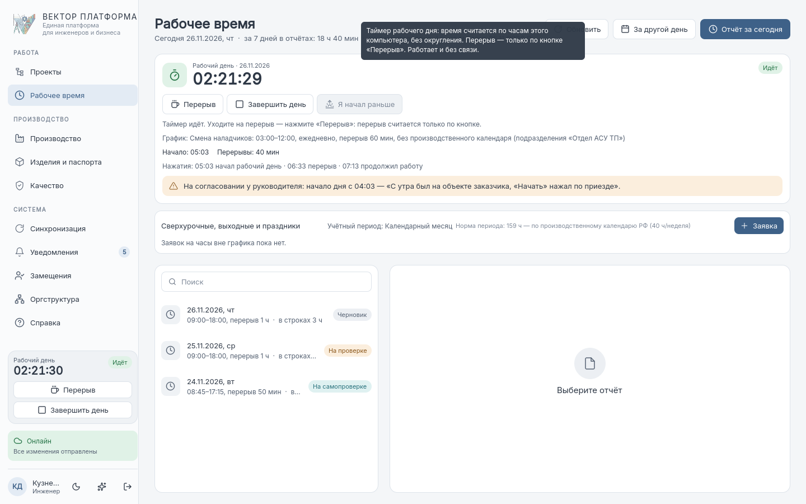

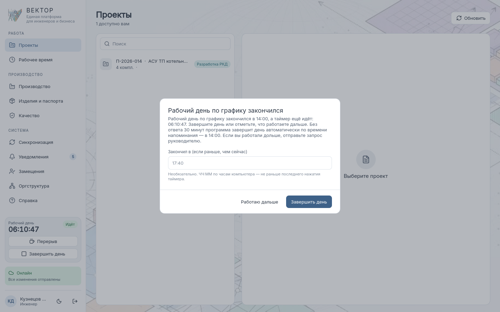

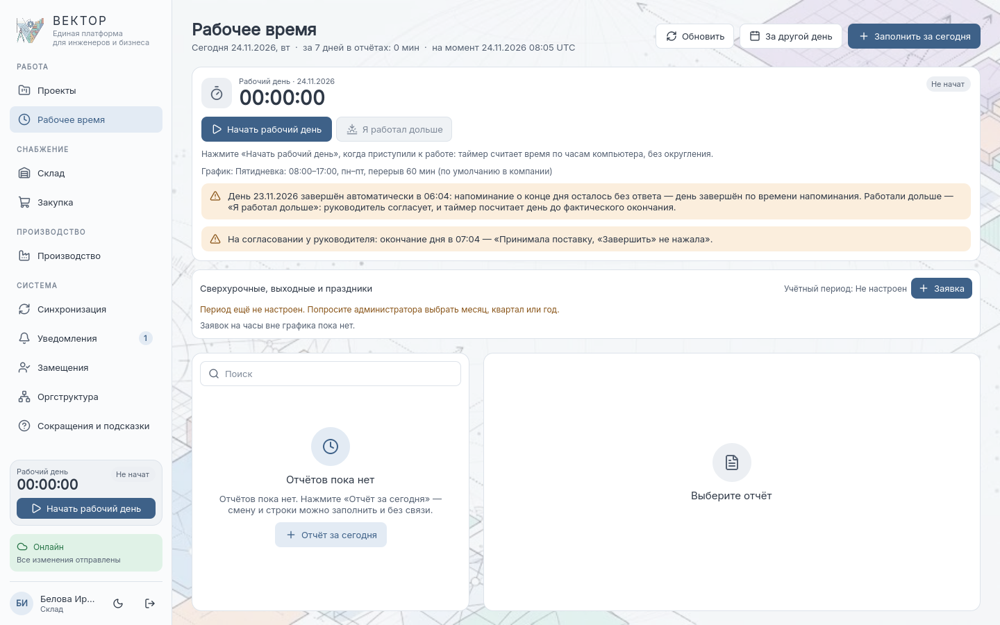

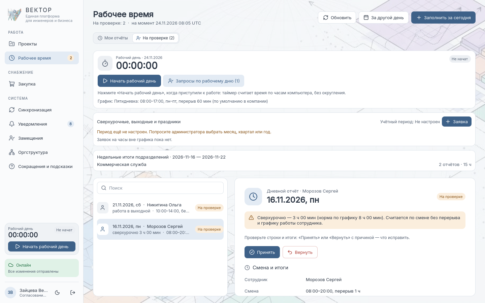

### Оргструктура

Раздел **«Оргструктура»** (в меню над «Справкой») есть **у всех**: дерево подразделений компании.

* **Виды:** **филиал** (обособленное подразделение в другом городе), **структура** (дирекция, управление, служба —
  объединяет отделы) и **отдел** (участок, группа). Во что входит подразделение, вид не ограничивает — но
  подразделение не может входить в само себя или в своё же подчинённое («круг»), и дерево — не глубже 12 уровней.
* **Карточка:** вид, код, «Входит в», полный путь («Головной офис › Инженерная дирекция › Отдел АСУ ТП»),
  руководитель, сотрудники с должностями, подчинённые подразделения и последние изменения (кто, когда, что было →
  что стало).
* **Под заголовком** — где вы в оргструктуре и **кто проверяет ваши дневные отчёты**.
* **Поиск** — по названию, коду, руководителю и сотрудникам; найденное видно вместе с вышестоящими.

Ведёт оргструктуру **каждый, у кого есть роль «Администратор»** (решение владельца, D-45), только при связи: **«Новое подразделение»**,
**«Изменить»** (название, код, «Входит в», руководитель), **«Включить сотрудника»** и **«Перевести»** (одно основное
подразделение и должность; должность — подпись, прав доступа не даёт), **«В архив»** — только пустое подразделение
(без сотрудников и действующих подчинённых), **«Вернуть из архива»**. Удаления нет: история сохраняется.

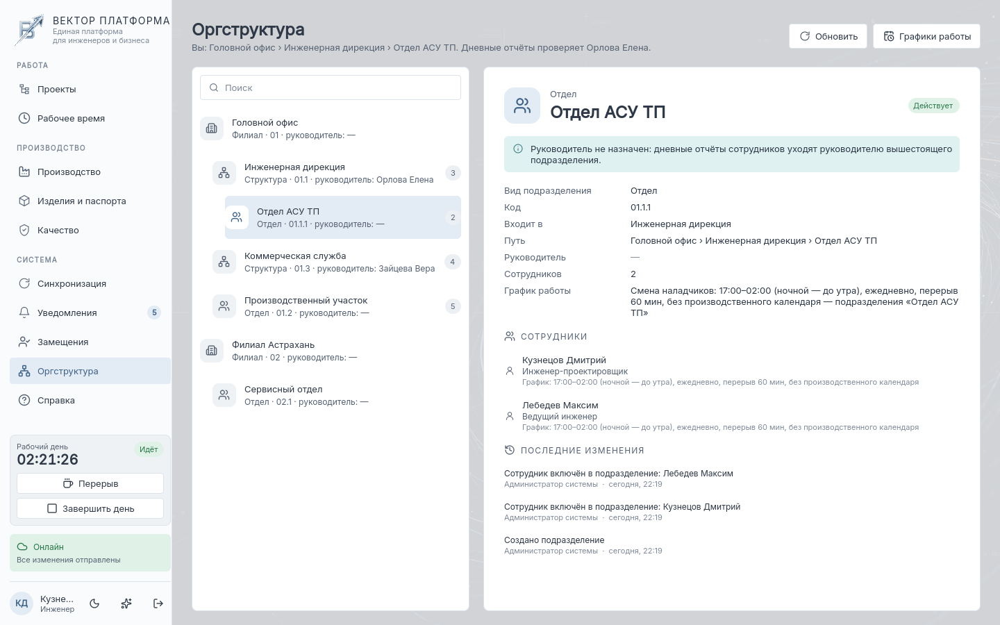

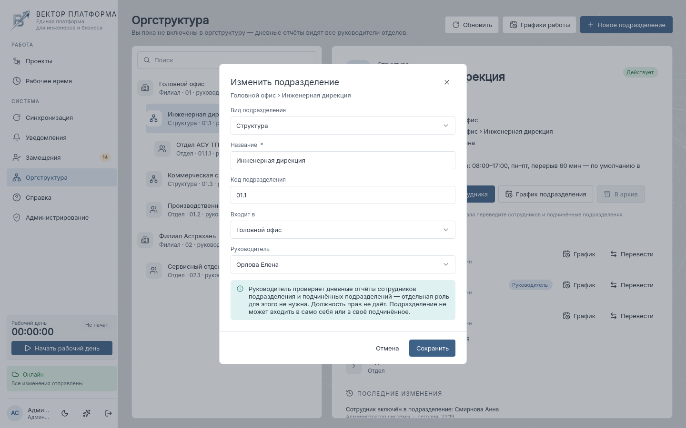

**Графики работы** (D-47) — кнопка **«Графики работы»** вверху раздела: справочник графиков компании (начало и конец
дня, рабочие дни недели, перерыв, какой — «по умолчанию», скольким назначен). В карточке подразделения — строка
«График работы» (действующий и откуда он: «подразделения …», «по умолчанию в компании»), у сотрудника — «График: …».
Какой график действует: назначенный лично → подразделения (или вышестоящего) → «по умолчанию» в компании → встроенный
09:00–18:00, пн–пт.

Администратор (только при связи): **«Новый график»** / **«Изменить»** (название, «Начало (ЧЧ:ММ)», «Конец (ЧЧ:ММ)» —
конец раньше начала значит ночной график, «Перерыв, мин», рабочие дни недели, «По умолчанию в компании», «В
архиве»); **«График подразделения»** в карточке и **«График»** у сотрудника → **«Назначить»**. Для служебных учётных
записей — «учёт рабочего времени не ведётся»: окно «Начните рабочий день» им не показывается. Сотрудник получает
уведомление о назначенном графике.

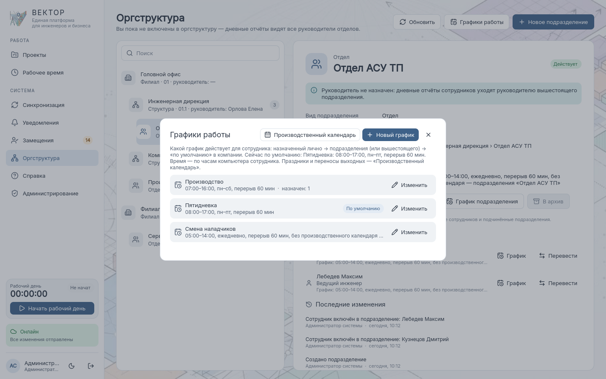

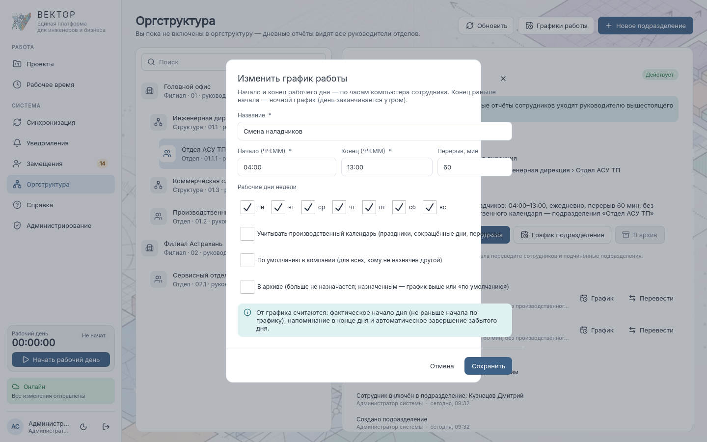

**Производственный календарь** (D-48) — кнопка **«Производственный календарь»** в окне «Графики работы» (видят все):
годы — прошлый, текущий, следующий (откуда календарь: загружен, встроенный в программу или его нет) и особые дни
выбранного года — праздники и перенесённые выходные, сокращённые на час, рабочие выходные по переносу; правки
администратора помечены. Администратор (при связи): **«Из интернета»** (с xmlcalendar.ru), **«Из файла»** (XML),
**«Изменить день»** (региональный праздник, решение компании). Календарь на следующий год программа администратора
загружает сама с октября. В форме графика — отметка **«Учитывать производственный календарь»** (круглосуточным сменам её
снимают).

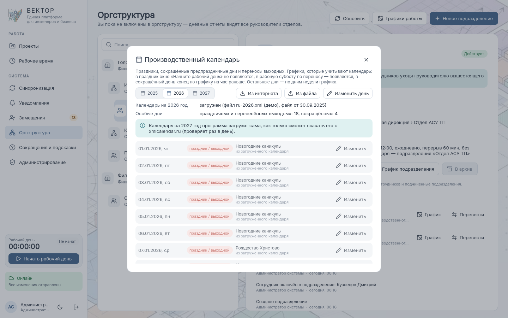

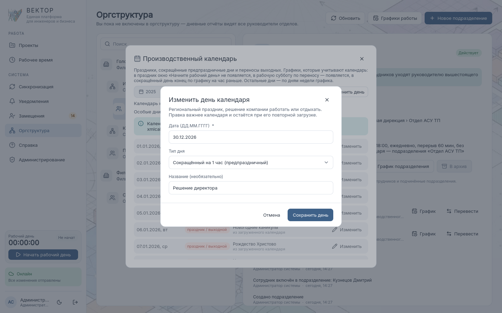

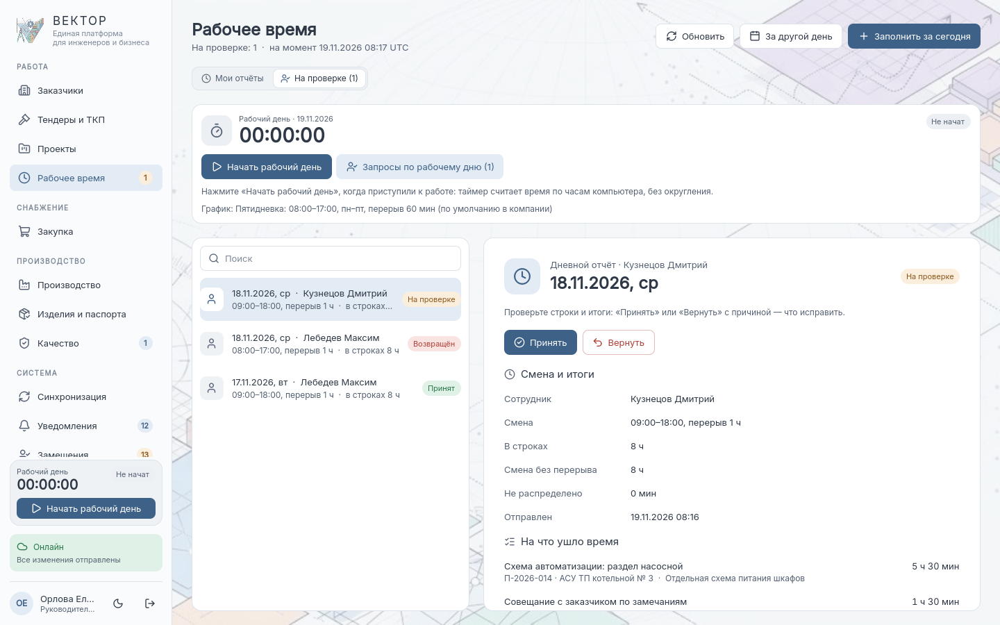

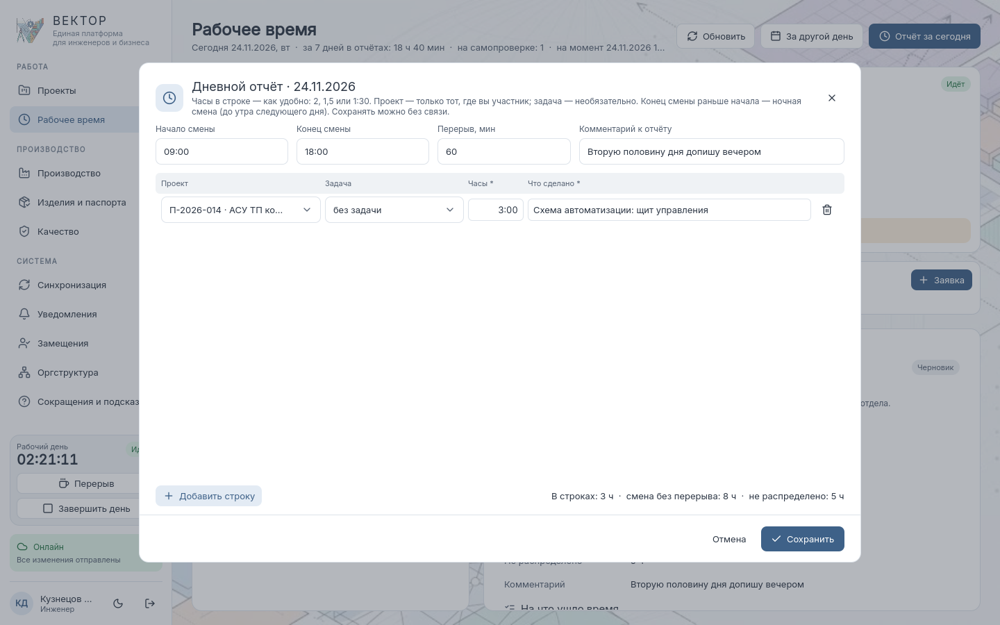

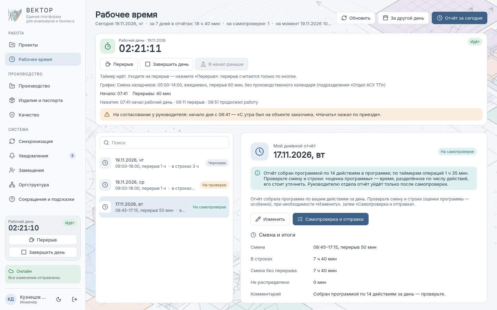

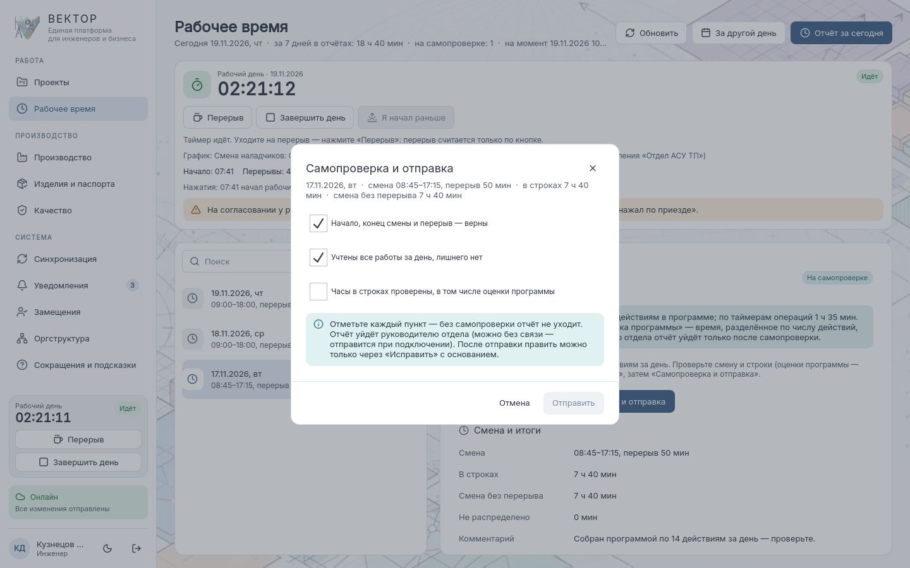

## 17. Администрирование

Только для роли «Администратор». Администратор управляет учётными записями, но **не получает** бизнес-прав
(не видит заказчиков, проекты, склад, если ему не выданы соответствующие роли).

* **Новый пользователь** — логин, имя, временный пароль; пользователь сменит его при первом входе.
* **Выдать роль / Отозвать** — с причиной. Отзыв действует сразу, в том числе для изменений, ожидающих в
  очереди у пользователя.
* **Отключить / Включить учётную запись** — отключённый пользователь не может войти, его сеансы завершаются. Нельзя отключить
  себя и последнего действующего администратора.
  Метка «Блок.» в списке означает временную блокировку после неудачных попыток входа.
* **Сбросить пароль** — временный пароль, снимает блокировку после неудачных попыток, завершает все сеансы.
* **Завершить все сеансы** пользователя (например, при утере ноутбука).
* **Настройки компании** (вкладка) — правила работы, которые меняет только администратор, при связи, с причиной.
  У каждой настройки видно действующее значение, кто, когда и почему его задал. «Не задано» означает, что
  действует самое строгое значение. Каждое изменение — новая версия; откат — публикация прежнего значения.
  Сейчас одна настройка — «Пересопоставление при резервах» (§ 14). Остальные пользователи видят эти правила
  в подсказках там, где они действуют.

  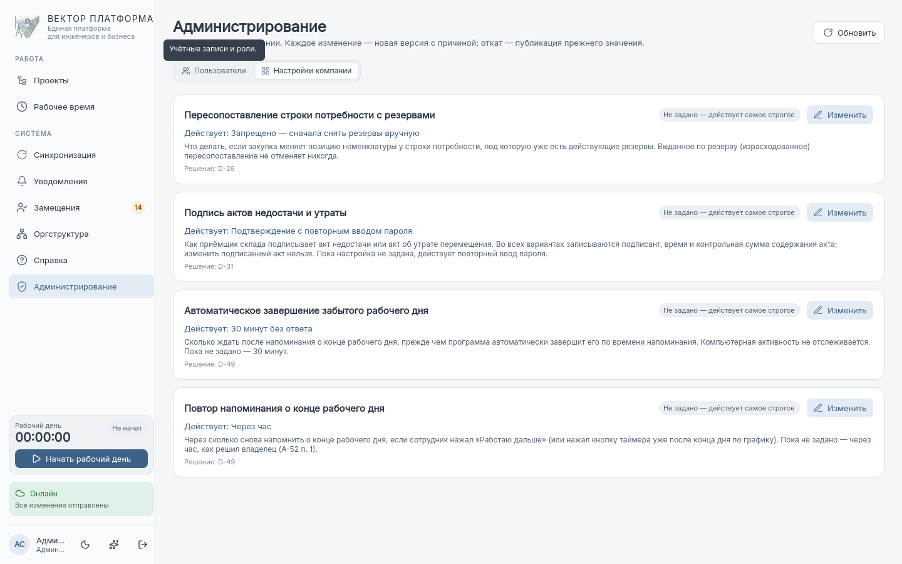

Подробнее — [admin-guide.md, § 7](admin-guide.md#7-пользователи-роли-и-доступ).

## 18. Горячие клавиши

| Клавиши | Действие |
|---|---|
| `Ctrl+1` / `Ctrl+2` / `Ctrl+3` | Заказчики / Тендеры и ТКП / Проекты |
| `Ctrl+4` | Синхронизация |
| `Ctrl+5` / `Ctrl+6` / `Ctrl+7` / `Ctrl+8` / `Ctrl+9` | Склад / Закупка / Производство / Изделия и паспорта / Качество (если доступны) |
| `Ctrl+0` | Рабочее время (дневной отчёт) |
| `F5` | Синхронизировать сейчас |
| `F1` | Сокращения и подсказки (§ 21) |
| `Tab` / `Shift+Tab` | Переход между полями и кнопками |
| `Enter` | Вход; подтверждение в форме |
| `Пробел` / `Enter` на вкладке | Выбрать вкладку |

## 19. Сообщения и что делать

| Сообщение | Что значит | Что делать |
|---|---|---|
| «Сохранено на этом компьютере и поставлено в очередь…» | Нет связи или ждём ответа сервера | Ничего; уйдёт само при связи |
| «…требует актуальной проверки сервера… не выполнено и не поставлено в очередь» | Действие только при связи | Повторите, когда появится связь |
| «Сначала синхронизируйте или разрешите ожидающие изменения» | В очереди есть неотправленное | Раздел «Синхронизация» |
| «Ответ сервера не получен: результат неизвестен» | Ответ потерян | «Синхронизировать» (`F5`) — повтор безопасен |
| «Объект изменён другим пользователем» (конфликт) | Коллега успел изменить | Решите в «Синхронизации» (§ 5) |
| «Нет права…» | Роль не позволяет | Обратитесь к руководителю/администратору |
| «Учётная запись временно заблокирована…» | 5 неудачных входов | Подождите 15 минут или к администратору |
| «Офлайн-работа доступна не дольше 7 дн.…» | Давно не было входа при связи | Подключитесь к сети компании |
| «Сертификат сервера не прошёл проверку» | Возможна подмена/ошибка настройки | Не продолжайте, к администратору |
| «Файл больше допустимого размера (N МБ)» | Предел сервера | Уменьшите файл или к администратору |
| «Файл повреждён при передаче… (контрольная сумма не совпала)» | Сбой сети | Повторите загрузку/скачивание |
| «Не более 4 знаков после запятой» | Ограничение точности | Округлите значение сами |
| «Движение № N — часть перемещения… Отдельно его не сторнируют» | Попытка сторно половины перемещения | В пути — примите или верните перемещение; после приёмки — обратное перемещение (§ 13) |
| «Перемещение уже в статусе «Принято» / «Возвращено отправителю»…» | Перемещение закрыл другой кладовщик | Обновите список; ничего не проведено повторно |
| «Акт не подписан: подтвердите, что вы — приёмщик…» | Акт без флажка подписи | Пересчитайте и отметьте «Подписываю акт…» |
| «Для подписи акта введите свой пароль» / «Пароль неверный — акт не подписан…» | В компании выбрана подпись с паролем | Введите пароль, которым входите в программу; ничего не проведено, пока пароль не верен |
| «Слишком много неверных паролей подписи. Подождите минуту.» | 5 неверных паролей подряд | Подождите минуту; забыли пароль — к администратору |
| «В настройках выбрана подпись КЭП, но она ещё не подключена…» | Администратор выбрал недоступный способ | К администратору: вернуть подпись с паролем |
| «Перемещение уже в статусе «Утрачено в пути»…» | Оформлен акт об утрате | Нашёлся груз — обычный приход с основанием «найдено по акту об утрате № N» |
| «Принято (…) больше, чем отгружено…» | Пришло больше отгруженного | Примите отгруженное, излишек — приходом с основанием |
| «Ожидаемая дата прибытия раньше дня отгрузки» | Срок в прошлом | Укажите дату не раньше сегодняшней (UTC) или оставьте поле пустым |
| «Склад-получатель … отключён: принять на него нельзя» | Склад отключили, пока товар был в пути | Включите склад (администратор склада) или верните перемещение отправителю |
| «Недостаточно доступного количества…» при отгрузке | Остаток на складе-отправителе занят резервами | Снимите резерв или отгрузите меньше |
| «По строке заказа ждём ещё N — принять M нельзя…» | Пришло больше, чем заказано | Примите остаток по заказу, излишек — обычным приходом с основанием (§ 14.2) |
| «Заказ № N уже размещён: поставщик, валюта и строки не меняются…» | Попытка править размещённый заказ | Меняйте только счёт, дату и примечание; другие условия — новый заказ (§ 14.1) |
| «По заказу № N уже есть поставки — отменить его нельзя…» | По заказу что-то принято | Закройте заказ с причиной или попросите склад сторнировать ошибочный приход |
| «Строка N: для строки потребности выбрана другая позиция номенклатуры…» | Позиция в заказе не та, что в потребности | Сначала сопоставьте строку потребности, затем заказывайте |
| «Поставщик «…» отключён — новые заказы ему не размещают» | Поставщика отключили | Выберите другого или включите карточку (вкладка «Поставщики») |
| «Заказ № N не согласован (…). Разместить можно только согласованный заказ…» | Согласование обязательно | «На согласование», дождитесь решения (§ 14.1) |
| «Заказ № N на согласовании / согласован: его условия не меняются…» | Условия заморожены на согласовании | Меняйте только счёт, дату и примечание; условия — «Отозвать с согласования» и отправить заново |
| «Содержание заказа № N отличается от согласованного…» / «…изменилось после отправки на согласование…» | Заказ изменён в обход программы | Отзовите и отправьте на согласование заново; сообщите администратору |
| «Нельзя согласовать заказ, который вы сами создали или отправили…» | Правило «четырёх глаз» | Согласует другой сотрудник с ролью «Согласование закупок» |
| «Укажите, как даны цены: с НДС или без НДС…» / «Укажите ставку НДС (или «Без НДС»)» | Без НДС заказ не согласовать | Выберите «Цены в счёте» и ставки строк в редакторе |
| «Договор № … заключён с другим поставщиком» / «…отключён…» / «…сегодня он не действует…» | Договор не подходит | Выберите другой договор, продлите этот («Поставщики» → договор → «Изменить») или оформите без договора |
| «У поставщика «…» уже есть договор № …» | Номер договора повторяется | Проверьте номер; правьте существующий договор |
| «Расчётный счёт не сходится с БИК (неверный контрольный ключ)…» / «…проверяется по БИК банка — укажите БИК» | Ошибка в реквизитах | Сверьте БИК и счёт с карточкой поставщика |
| «Расхождение со счётом поставщика… укажите причину расхождения» | Расчёт не совпал с суммами из счёта или сверить нельзя | Проверьте цены и суммы по счёту; если всё верно — укажите причину в форме отправки (§ 14.1) |
| «Расчёт НДС не прошёл самопроверку — суммы не показываются…» | Два независимых расчёта НДС разошлись | Ничего не отправляйте; сообщите администратору (§ 14.1) |
| ««Сумма по счёту с НДС» — в рублях и копейках…» | Больше двух знаков после запятой | Введите сумму как в счёте |
| «Такое замещение на эти даты уже оформлено» / «У сотрудника уже есть своя роль…» | Замещение не нужно или уже есть | Проверьте список в «Замещениях» (§ 14.4) |
| «У вас нет своей роли … полученную замещением роль дальше не передают» | Попытка передать полученную роль | Попросите руководителя отдела оформить замещение за носителя роли |
| «Назначить замещающим себя нельзя…» | Руководитель оформляет замещение на себя | Пусть оформит сам носитель роли, другой руководитель или администратор |
| «У сотрудника «…» нет действующей роли «ГИП в проекте П-…» — передавать нечего» | Сотрудника сняли с проекта или роль другая | Проверьте команду проекта; передать можно только действующее назначение |
| «Исполнителем может быть только участник команды этого проекта или его замещающий» | Выбран человек вне команды | Назначьте участника или оформите замещение в проекте (§ 14.4) |
| «Свой ТП утвердить нельзя…» | Четыре глаза: автор не утверждает | Попросите другого технолога или руководителя отдела |
| «У этого комплекта уже есть черновик ТП…» | Один черновик на комплект | Откройте черновик в «Техпроцессах» и продолжите его |
| «Наряд выпускается только по утверждённому ТП» | ТП ещё черновик или его утверждение недействительно | Утвердите ТП (другой технолог) |
| «Операция назначена другому исполнителю…» (конфликт отметки) | Пока вы были без связи, операцию переназначили | Уточните у РП; отметку отмените в «Синхронизации» |
| «Время события в будущем — проверьте часы компьютера…» | Часы компьютера спешат больше чем на 15 минут | Поправьте время Windows и повторите отметку |
| «Закрыть пока нельзя: не все операции выполнены / материалы выданы не полностью» | Условия закрытия наряда (A-43) | Дождитесь отметок исполнителей; склад выдаёт материалы с выбором наряда |
| «Состав наряда изменился после предпросмотра…» | Пока вы смотрели замену, кто-то изменил состав | Откройте замену заново и проверьте |
| «Локальные данные повреждены или изменены вне программы» | Локальная копия испорчена | К администратору: очистка локального кэша (неотправленное будет потеряно) |
| «В строках … — больше, чем смена без перерыва…» | В дневном отчёте часов больше, чем длится смена | Исправьте часы в строках или смену (§ 16) |
| «Отчёт за … уже есть — откройте его» | Дневной отчёт за этот день уже заведён | Выберите его в списке «Мои отчёты» |
| «Новый отчёт — не старше 31 дня…» | Слишком давний день | Обратитесь к руководителю отдела (§ 16) |
| «Свой дневной отчёт проверяет другой руководитель» | Руководитель отдела пытается принять свой отчёт | Отчёт примет другой руководитель отдела или замещающий |

## 20. Вопросы и ответы

**Почему я не вижу раздел/кнопку?** Нет нужной роли или назначения в проекте. Состав прав —
[reference.md](reference.md).

**Почему число «доступно» другое, чем у коллеги?** Без связи вы видите снимок «на момент …». Нажмите `F5`.

**Можно ли вернуть удалённую/исправленную версию документа?** Версии не удаляются и не меняются — все прежние
версии доступны для скачивания.

**Почему итог проекта не изменился после правки расчёта?** Итог считается только из **зафиксированных** версий.
Попросите ГИП зафиксировать расчёт.

**Где хранятся мои данные?** На сервере компании. На компьютере — зашифрованная рабочая копия
(`%LOCALAPPDATA%\VECTOR\profiles`), которую нельзя открыть без вашего пароля и вашей учётной записи Windows.

**Что значит это сокращение?** Наведите на него мышь — подсказка расшифрует его; полный список — § 21 и `F1`.

## 21. Сокращения и подсказки

**Подсказки при наведении.** У каждой кнопки, пункта меню, вкладки, метки статуса, подписи поля и заголовка секции
есть всплывающая подсказка: задержите указатель на полсекунды. В ней:

* **что сделает действие** или что значит статус («Сторно — исправить ошибочную запись обратной записью…»);
* **нужна ли связь**: «Только при связи с сервером» или «Можно без связи: сохранится в очереди и уйдёт на сервер при
  подключении»;
* **расшифровка всех сокращений** из текста элемента («ТП — технологический процесс…»);
* полный текст, если он не поместился и обрезан многоточием.

Неактивная (серая) кнопка подсказку не показывает: причина, почему действие недоступно, написана в плашке рядом.

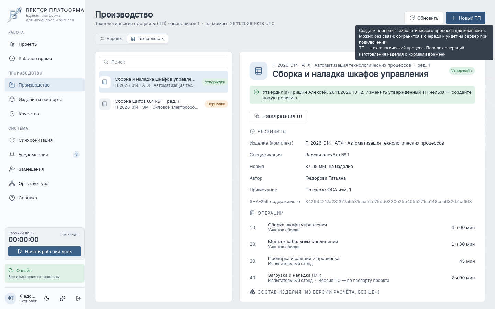

**Раздел «Сокращения и подсказки»** (меню «Система», клавиша `F1`) — справочник всех сокращений программы с
поиском по сокращению, полному названию и пояснению, памятка по подсказкам и горячие клавиши. Работает и без
связи. В списках выбора роли сокращения расшифрованы: «ГИП (главный инженер проекта)», «РП (руководитель проекта)».

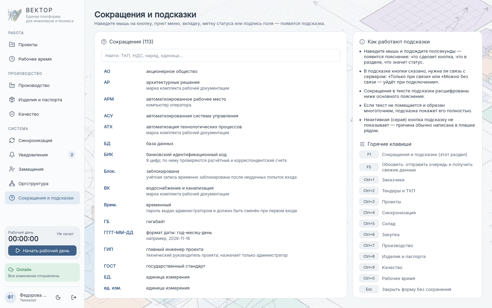

Тот же список сокращений в документации — [reference.md, § 5](reference.md#5-сокращения).

## ПНР и приёмочные испытания (FAT)

**Запрос ПНР.** Участник проекта создаёт запрос на внутреннюю наладку или на выезд к заказчику (площадочная ПНР):
указывает название, нужно ли питание для проверки, плановую дату. Дальше запрос ведёт РП проекта: назначает дату,
переводит в выполнение, завершает; отмена — только с причиной.

**Шаблоны чек-листов.** Разделы проверки и градации замечаний (несущественное / существенное / блокирующее — или
свои) настраивает начальник сервисной службы. В каждом шаблоне обязательно есть блокирующая градация — иначе
нельзя было бы остановить отгрузку. Правка шаблона не переписывает уже проведённые испытания: каждая проверка
хранит снимок чек-листа на момент начала.

**Испытание (FAT).** РП начинает испытание по шаблону — предварительное или финальное (приёмочное). В ходе
испытания участники фиксируют замечания по разделам чек-листа с градацией; замечание относится к проекту, а не
к человеку. Испытание завершается итогом «успешен» или «неуспешен» (с причиной); итог неизменяем — повторная
проверка оформляется новым испытанием.

**Блокировка отгрузки.** Перевести поток «Отгрузка» в «Отгружена» можно только когда последнее финальное
испытание успешно и по нему нет открытых блокирующих замечаний. Предварительные испытания на отгрузку и
показатели не влияют — они для ранней проверки. Если финальный FAT неуспешен: устраните замечания (каждое
закрывается с записью, что сделано) и проведите новое приёмочное испытание.

**Документы доставки.** Отдел логистики оформляет сопроводительные документы (ТОРГ-12, УПД, упаковочный лист) по
настраиваемым формам: начальник логистики ведёт шаблоны с плейсхолдерами `{{поле}}`, документ при выписке сам
подставляет данные проекта и комплекта (`{{project.code}}`, `{{customer.name}}`, `{{kit.code}}` и т. п.), а
транспорт и примечания логист дописывает вручную. Выписанный документ — снимок: последующая правка формы его не
меняет.
